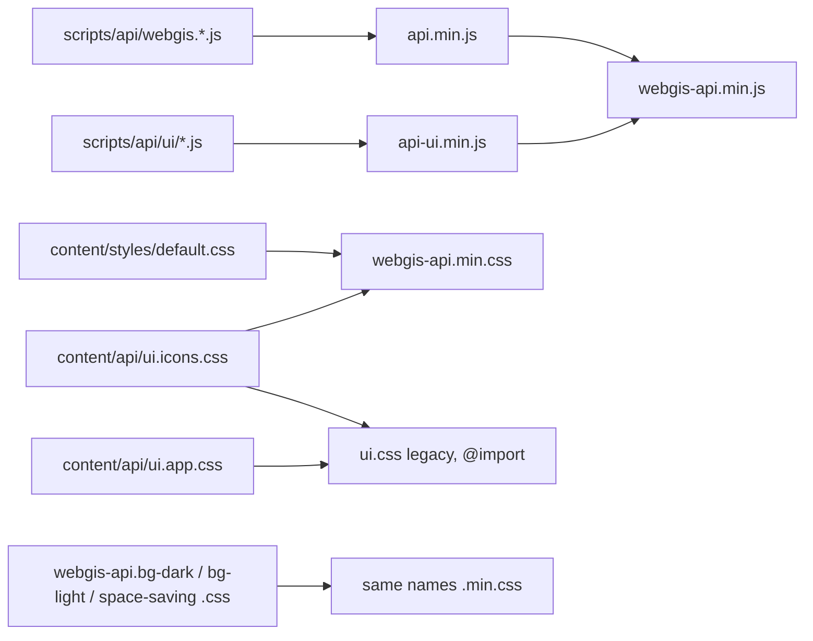

# API JavaScript & CSS Bundles

## Overview

The WebGIS API ships its viewer JavaScript and styles as bundles built by BuildBundlerMinifier.
Besides the historic split into a core bundle (`api.min.js`) and a UI bundle (`api-ui.min.js`) with
separate stylesheets (`default.css`, `ui.css`), a **single bundle** (`webgis-api.min.js` +
`webgis-api.min.css`) is built additionally, so clients only need one script and one stylesheet.
The old files are deprecated but stay available for existing clients; all internal pages and templates use the single bundle.

## Affected projects

| Project | Role |
|---------|------|
| `webgis-api` | Hosts the sources in `wwwroot`, defines all bundles in `bundleconfig.json` (built on project build). |
| `webgis-portal` | Views (`Map`, `MapBuilder`, `AppBuilder`, `Home/Portal`, `Home/Cloud`) and HTML templates (`_templates`, `_mapbuilder`) include the single bundle; the viewer also loads the minified style overlays. |
| `WebGIS.UI.Tests` | Guards the single bundle definition and smoke-tests loading it. |
| `_build` | Release build: replaces the JS version placeholder in the published bundles. |

## Key classes / files

| Class / file | Responsibility |
|--------------|----------------|
| `src/NetCore/Web/Api/bundleconfig.json` | Bundle definitions; the single bundle entries follow `api.min.js`/`api-ui.min.js`. |
| `.../wwwroot/scripts/api/api.min.js`, `api-ui.min.js` | Core and UI bundles built from the single source files (still supported). |
| `.../wwwroot/scripts/api/webgis-api.min.js` | Single bundle: `api.min.js` + `api-ui.min.js` concatenated, not re-minified. |
| `.../wwwroot/content/styles/webgis-api.min.css` | Minified `content/styles/default.css` + `content/api/ui.icons.css`. |
| `.../wwwroot/content/api/ui.icons.css`, `ui.app.css`, `ui.css` | Icon rules (bundled); page-global app rules (no text selection, no pull-to-refresh, loaded separately by full-page apps); legacy `ui.css` only `@import`s both. |
| `AddDataLinqServices` options (`src/NetCore/Web/Api/AppCode/Extensions/DependencyInjection/ServiceCollectionExtensions.cs`) | DataLinq reports include the single bundle (without `ui.app.css`). |
| `.../wwwroot/content/styles/webgis-api.{bg-dark,bg-light,space-saving}.css` | Viewer style overlays (sources), bundled to `*.min.css`. |
| `.../wwwroot/scripts/api/webgis.js` | Derives `webgis.baseUrl` from the script with `id="webgis-api-script"`, falling back to `document.currentScript`. |
| `ApiJavaScriptService` (`src/NetCore/Web/Api/AppCode/Services/ApiJavaScriptService.cs`) | Reads the deployed JS version from `api.min.js`. |
| `build/Build.cs` | Replaces `{{currentJavascriptVersion}}` in `webgis.js`, `api.min.js` and `webgis-api.min.js`. |
| `BundleConfig` (`src/NetCore/Tests/WebGIS.UI.Tests/Infrastructure/BundleConfig.cs`) | Reads `bundleconfig.json` for the tests. |
| `SingleBundleConfigTests`, `SingleBundleSmokeTests` (`.../WebGIS.UI.Tests/UIBuilder/HarnessTests.cs`) | Check the single bundle definition/content and load it without script id. |

## Flow

## Configuration

No configuration. Clients choose the files they include:

| Include | Files |
|---------|-------|
| Recommended | `content/styles/webgis-api.min.css`, `scripts/api/webgis-api.min.js` (+ `content/api/ui.app.css` for full-page apps) |
| Legacy (deprecated, supported) | `content/styles/default.css`, `content/api/ui.css`, `scripts/api/api.min.js`, `scripts/api/api-ui.min.js` |

User docs: https://docs.webgiscloud.com/en/webgis-dev/API/API_JavaScript/index.html#api-javascript-single-bundle

## Design decisions

- The single bundle concatenates the already built bundles instead of repeating the source file
  list, so a new source file is only registered once (in `api.min.js` or `api-ui.min.js`).
- The old bundles and `default.css` are kept and maintained, because existing clients include them.
- Location is fixed by existing code: the JS must live in `scripts/api/` (`webgis.baseUrl` is cut at
  `/scripts/api/`), the CSS in `content/styles/` so the relative `../api/img/...` URLs of
  `default.css` stay valid (the bundler rewrites the relative URLs of `ui.icons.css`).
- `ui.css` was split because its page-global rules (`user-select: none`, `overscroll-behavior`) must not hit pages that only embed the API (DataLinq reports, portal page); `ui.css` keeps the old behavior via `@import` (not concatenated, an `@import` inside a bundle would be invalid).
- Viewer and MapBuilder load `default.css` + `ui.icons.css` in `Development` (like the single JS files), so CSS edits are visible without a rebuild.
- The portal page loads `webgis-api.min.js` for all users (`api.min.js` is deprecated); the stylesheet only for content authors/page owners.
- The style overlays were renamed (not duplicated) because they are only used by the viewer page.
- Name `webgis-api.*` instead of `webgis.min.js`, which would look like a minified `webgis.js`.

## Pitfalls / things to watch

- The single bundle entry must stay **after** both source bundles in `bundleconfig.json` and keep
  `minify.enabled = false`; `SingleBundleConfigTests` checks both.
- Never add source files to `webgis-api.min.js` directly.
- The inputs must end with `;` (they do, as minified output) - concatenation inserts only line breaks.
- The bundles are git-ignored; they exist only after building `webgis-api`.
- In the viewer, MapBuilder and AppBuilder `webgis-api.min.css` takes the old position of `default.css`, so company/page custom CSS now also overrides the icon rules (formerly `ui.css` came after them).
- `ApiJavaScriptService` still reads the version from `api.min.js`; switch it when the old bundles
  are removed.

## History

| Version | Change | Reference |
|---------|--------|-----------|
| `9.26.4104` | Single bundle `webgis-api.min.js`/`.min.css`, overlays renamed to `webgis-api.*`, `document.currentScript` fallback. | - |
| `9.26.4104` | Internal pages, templates and DataLinq switched to the single bundle; `ui.css` split into `ui.icons.css` (bundled) and `ui.app.css`. | - |
