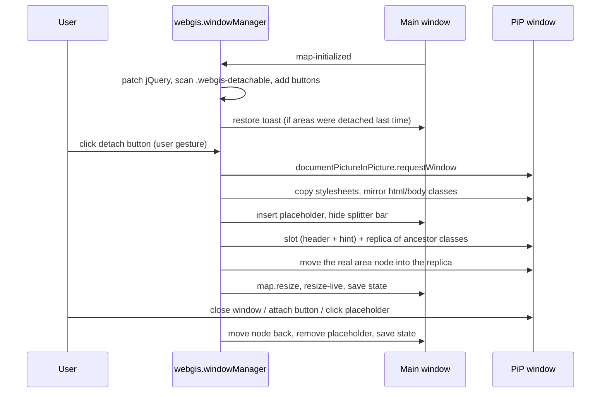

# Detachable Windows

## Overview

Areas of the viewer layout (currently the toolbar and the query results table) can be detached
into a separate browser window, so the viewer behaves more like a desktop application (e.g. table
on a second screen). The window is opened with the Document Picture-in-Picture API (Chromium only)
and managed by `webgis.windowManager`; the rest of the viewer code stays (almost) unaware of it.

## Affected projects

| Project | Role |
|---------|------|
| `webgis-api` | `webgis.windowManager`, CSS of the detached window, small overlay adjustments in the modal/context menu plugins, l10n, `detachableWindows` option, bundle registration. |
| `webgis-portal` | Marks the detachable areas in the viewer layout (`w1200_desktop.html`), loads the script in the unbundled views, enables the option in the `default` portal's `custom.js`. |

## Key classes / files

| Class / file | Responsibility |
|--------------|----------------|
| `webgis.windowManager` (`src/NetCore/Web/Api/wwwroot/scripts/api/webgis.window-manager.js`) | Scans `.webgis-detachable` areas, adds detach buttons, opens/closes the PiP window, moves the DOM nodes, placeholders, slot layout, jQuery hooks, keyboard forwarding, localStorage state, restore toast, "area hidden" hint. |
| `webgis_modalDialog` / `webgis.ui.showModal` (`.../scripts/api/ui/webgis.ui.plugins.modal.js`) | Uses `windowManager.overlayContainer` and the owner window of the dialog for size calculations. |
| `webgis_contextMenu` / `webgis.ui.showContextMenu` (`.../scripts/api/ui/webgis.ui.plugins.contextMenu.js`) | Same for context menus (opened in the window where the click happened). |
| `webgis_toolbar` (`.../scripts/api/ui/webgis.ui.plugins.toolbar.js`) | Writes `data-title` on each tab content, used as block title in the detached "ribbon" layout. |
| `webgis_toolbox` (`.../scripts/api/ui/webgis.ui.plugins.toolbox.js`) | Registers its `onchangeactivetool` handler before the `no-toolbox` early return, so the `selected` state also works after a re-init. |
| `default.css` (`src/NetCore/Web/Api/wwwroot/content/styles/default.css`) | Detach button, placeholder, toast, detached container/slots/hint and the PiP toolbar layout (`.webgis-detached` ...). |
| `webgis-api.space-saving.css` (`.../content/styles/webgis-api.space-saving.css`) | Detach button height in the space-saving mode. |
| `webgis.l10n.de.js` / `webgis.l10n.en.js` (`.../scripts/api/`) | `windowmanager-*` keys (button tooltips, area titles, toast, hint). |
| `w1200_desktop.html` (`src/NetCore/Web/Portal/viewerlayouts/__default/w1200_desktop.html`) | `#toolbar` and `.query-results-tab-control-container` carry `webgis-detachable` + `data-detachable-*`. |

## Flow

Hint for hidden areas: a `MutationObserver` on the area root (`style`/`class`) and the map's
`onchangeactivetool` event update a hint in the slot. If the area is `display:none` (e.g. the
print tool hides `.webgis-map-overlay-ui-element`), the hint and a "close active tool" button
(with the tool's icon, not for the default tool) are shown. The button triggers the close of the
primary tool dialog header (same path as its "x", incl. discard confirmation), fallback
`map.setParentTool()`.

## Configuration

| Setting | Where | Default | Description |
|---------|-------|---------|-------------|
| `webgis.usability.detachableWindows` | `custom.js` | `false` | Enables the window manager (only effective if `documentPictureInPicture` is available). |
| `webgis-detachable` | viewer layout (CSS class) | - | Marks an area as detachable. Nested areas are ignored. |
| `data-detachable-id` | viewer layout | element id | Stable id, used in localStorage. |
| `data-detachable-title` | viewer layout | id | l10n key or text for the slot header/placeholder. |
| `data-detachable-order` | viewer layout | `0` | Order of the areas in the shared window. |
| `data-detachable-icon-target` | viewer layout | area itself | Selector inside the area where the detach button is placed. |
| `data-detachable-size` | viewer layout | `auto` | `fill` (area fills its slot) or `auto` (content height). |

State (`detached` ids, window `width`/`height`, `sizes`, `dontAsk`) is stored in localStorage
under `webgis-windowmanager-<portal pageId>`.

## Design decisions

- **Document Picture-in-Picture** instead of `window.open`: same-origin document that can host the
  real DOM nodes; it stays on top and is closed together with the viewer. Not supported browsers
  simply get no detach buttons.
- **Move the real nodes** instead of re-rendering: jQuery data, events and plugin state stay intact,
  so tools, toolbar and table plugins need no changes.
- **jQuery hooks** (`$()`, `.find()`, `.closest()`, `$('#id')`) make lookups in the main document
  also find the detached nodes, and `.closest()` in the PiP continues at the original ancestors.
  This avoids touching the many existing selectors in the viewer.
- **Replica of ancestor classes** (without ids) around the moved node, so CSS rules with parent
  selectors and theme variables of `.webgis-container` also apply in the PiP window.
- **One shared window** for all detached areas (PiP allows only one per opener), stacked as slots.
- **No automatic restore**: the PiP window can only be opened from a user gesture, so a toast asks
  the user (restore / no / don't ask again).
- Overlays (modals, context menus) open in the PiP window only if they belong to it or the user is
  working there and the window is big enough (400x300), otherwise in the main window.

## Pitfalls / things to watch

- Code that uses the global `window`/`document` for sizes or events does not see the PiP window;
  use the owner document of the element (see modal/context menu plugins).
- CSS is only copied from the main window (incl. later added `<style>`/`<link>` nodes). Elements
  outside the replica (slot header, hint) must set the viewer font themselves; toast and slot
  header set `font-family` explicitly.
- Do not compound `font-size: .73em`: the replica already carries the `.webgis-container` class.
- Plugins that are destroyed/re-initialized must register their map event handlers before any
  early return (see the `no-toolbox` fix in `webgis_toolbox`).
- The splitter height remembered when detaching can be outdated when attaching (e.g. detached
  while still collapsed via the restore toast). For the query results area the manager therefore
  calls `map.ui._setResultFrameSize` after attaching (only after `_updateMounts()`, otherwise the
  jQuery hooks would still return the area twice).
- Testing: Playwright with Chrome (headed) - the PiP window shows up as an additional page
  (`about:blank`) in the browser context.

## History

| Version | Change | Reference |
|---------|--------|-----------|
| `9.26.4104` | Initial version: detachable toolbar and query results table, restore toast, hint for areas hidden by the active tool. | |
