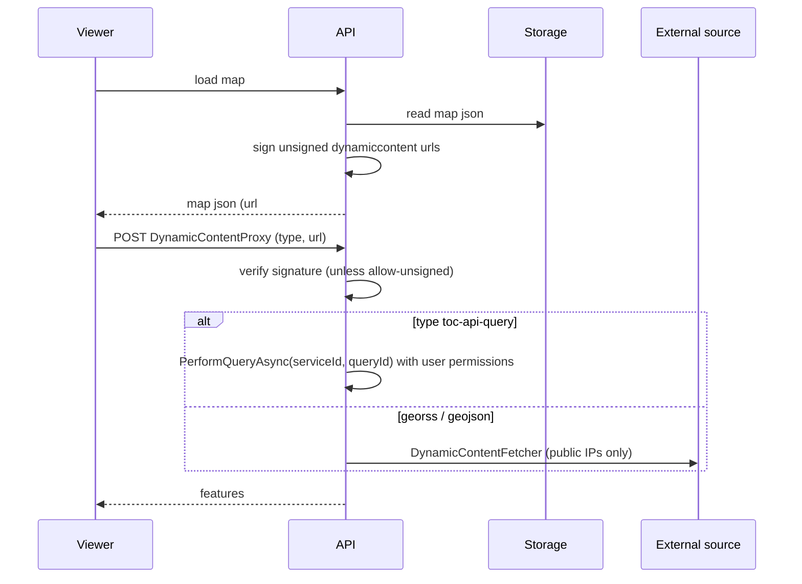
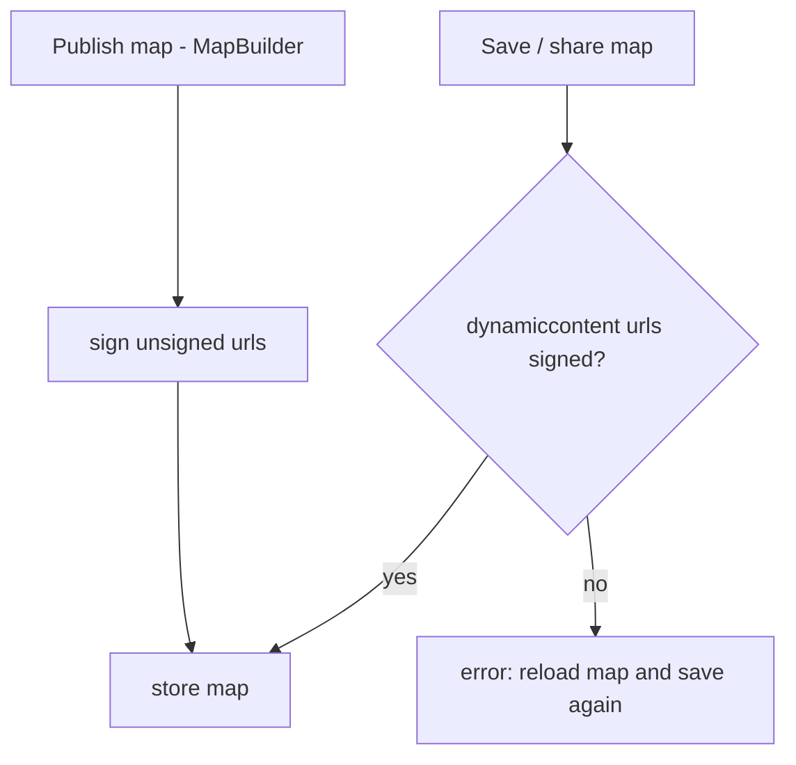

# Dynamic Content Security

## Overview

Dynamic content (GeoRSS, GeoJSON, API queries, TOC theme markers) is loaded by the viewer through the
`DynamicContentProxy` of the API, which downloads external urls server-side. To prevent SSRF and
manipulated urls, the download is restricted to public targets and the urls of dynamic content are
signed by the API. The client can no longer introduce arbitrary urls.

## Affected projects

| Project | Role |
|---------|------|
| `webgis-api.csproj` | `DynamicContentProxy`, request parsing, settings from `api.config`, signing of tool event responses |
| `E.Standard.Api.App.csproj` | `DynamicContentFetcher` (SSRF-safe download) and `DynamicContentSettings` |
| `E.Standard.WebMapping.Core.Api.csproj` | `DynamicContentSignature` (sign/verify, map json processing) |
| `E.Standard.WebGIS.Tools.csproj` | Signing on map load and publish, signature check on save/share |

## Key classes / files

| Class / file | Responsibility |
|--------------|----------------|
| `DynamicContentProxy` (`src/NetCore/Web/Api/Controllers/RestController.cs`) | Entry point (`/rest/DynamicContentProxy`); dispatches by type (`toc-api-query`, `api-query`, `georss`, `geojson`, `geojson-embedded`) |
| `DynamicContentRequestExtensions` (`src/NetCore/Web/Api/AppCode/Extensions/DynamicContentRequestExtensions.cs`) | Verifies the signature of the posted url before placeholders/bbox are replaced |
| `DynamicContentSignature` (`src/NetStandard/E.Standard.WebMapping.Core.Api/Extensions/DynamicContentSignature.cs`) | `Sign`, `Unwrap`, `SignMapJson`, `EnsureMapJsonSigned`, `RequiresSignature`, `TocApiQueryType` |
| `DynamicContentFetcher` (`src/NetStandard/E.Standard.Api.App/Services/DynamicContentFetcher.cs`) | Download with connect-time IP check, manual redirects, timeout, size limit |
| `DynamicContentSettings` (`src/NetStandard/E.Standard.Api.App/Services/DynamicContentSettings.cs`) | Static settings (`AllowedHosts`, `TimeoutSeconds`, `MaxResponseBytes`, `MaxRedirects`, `AllowUnsigned`) |
| `ApiGlobalsService` (`src/NetCore/Web/Api/AppCode/Services/ApiGlobalsService.cs`) | Reads the `dynamic-content:*` keys from `api.config` |
| `ReplaceLegacyMapJsonItemsAndSignDynamicContent` (`src/NetStandard/E.Standard.WebGIS.Tools/Extensions/LegacyExtensions.cs`) | Legacy map json replacement plus signing |
| `LoadMap`, `Publish.MapJson` (`src/NetStandard/E.Standard.WebGIS.Tools/Serialization/LoadMap.cs`, `.../Portal/Publish.cs`) | Deliver maps with signed dynamic content |
| `SaveMap`, `ShareMap` (`.../Serialization/SaveMap.cs`, `.../Serialization/ShareMap.cs`) | Reject unsigned dynamic content on save/share |
| `Publish.OnSaveMap` (`.../Portal/Publish.cs`) | `publish-map` (MapBuilder, trusted authors): signs unsigned dynamic content instead of rejecting |
| `Publish.SignDynamicContent` (`.../Portal/Publish.cs`) | Tool command `sign-dynamic-content`: signs a json array of dynamic content for MapBuilder html snippets |
| `webgis-mapbuilder.js` (`src/NetCore/Web/Portal/wwwroot/scripts/webgis-mapbuilder.js`) | Calls `sign-dynamic-content` before `mapbuilder/createtemplate` |
| `RestToolsHelperService` (`src/NetCore/Web/Api/AppCode/Services/Rest/RestToolsHelperService.cs`) | Signs urls of `ApiDynamicContentEventResponse` |
| `webgis_presentationToc.js` (`src/NetCore/Web/Api/wwwroot/scripts/api/ui/webgis_presentationToc.js`) | TOC theme marker: sends `toc-api-query` with `serviceId@queryId` |

## Flow

## Configuration

| Setting | Where | Default | Description |
|---------|-------|---------|-------------|
| `dynamic-content:allow-hosts` | `api.config` | empty | Hosts / `*.domain` patterns that may resolve to non-public addresses |
| `dynamic-content:timeout-seconds` | `api.config` | `20` | Download timeout |
| `dynamic-content:max-response-bytes` | `api.config` | `52428800` | Maximum response size |
| `dynamic-content:max-redirects` | `api.config` | `5` | Redirects followed (each hop validated) |
| `dynamic-content:allow-unsigned` | `api.config` | `false` | Also process urls without valid signature |

User docs: https://docs.webgiscloud.com/en/webgis/config/api/index.html#api-config-dynamic-content

## Design decisions

- **Signature instead of host allowlist only:** The urls are admin/map-author content. Signing on map load plus a signature check on save/share makes sure normal users can only store urls the API has seen. Publishing (MapBuilder) is reserved for trusted map authors and signs instead, so existing dynamic content of a loaded map can be re-published.
- **Signature format:** `Base64(SHA256(StaticDefaultEncrypt_Aes("dynamic-content|{type}|{url}")))`, appended as `#webgis-sig=...` to the url, so it survives the client round-trip. It uses the static `DefaultPassword` of the `ICryptoService` (like `VisFilterDefinitionDTOExtensions.CalcSignature`), because the service offers no HMAC. All API instances sharing a storage need the same `DefaultPassword`.
- **Verification before placeholders:** Placeholders (`{lng_min}`, user placeholders) are part of the signed template and are replaced by the server afterwards.
- **Connect-time IP check:** Validating the resolved address in the `ConnectCallback` prevents DNS rebinding; redirects are followed manually and validated per hop. With a configured `WebProxy` the host is resolved and checked before each request.
- **`toc-api-query`:** TOC theme markers no longer send a url. The client only sends `serviceId@queryId` (split at the last `@`, because service ids look like `cmsservice@cmsid`); the server loads the query for the user, so existence and permission are checked and nothing needs to be signed.
- **Secure default:** `allow-unsigned` is `false`; admins opt in to less security.
- **Signing command for html snippets:** The Portal renders MapBuilder html snippets itself and has no key, so the MapBuilder client signs the dynamic content first via the API tool command `sign-dynamic-content` (`Publish`).
- Rejected: strict host allowlist only (too much admin effort).

## Pitfalls / things to watch

- `publish-map`, `sign-dynamic-content` and the other writing commands of `Publish`/`PublishApp`/`Master` are restricted on the API side to map authors of the portal page (`[PortalMapAuthorRequired]`, `PortalMapAuthorAuthorizationService`, checked in `RestController.ToolMethod` and for `servertoolcommand` events). The page id is taken from the tool's storage path, so callers must send `page-id` (the MapBuilder does this for `sign-dynamic-content`). The host/IP checks of the fetcher still apply.
- HTML snippets created by the MapBuilder (Portal `CreateTemplate`) are signed on the client side beforehand (`webgis-mapbuilder.js` calls `sign-dynamic-content`). Snippets created with older versions stay unsigned and need `allow-unsigned=true` or a new snippet.
- Urls set in `custom.js` are unsigned.
- Changing the `DefaultPassword` invalidates all signatures; maps are re-signed on the next load, but unsigned maps in the client must be reloaded before saving.
- A new place that stores or delivers a map json has to use `ReplaceLegacyMapJsonItemsAndSignDynamicContent` (deliver) or `EnsureMapJsonSigned` (store).
- New server code that creates dynamic content must sign it (see `RestToolsHelperService`).
- Not run-tested against a real viewer session: test georss/geojson, a tool result with dynamic content, a TOC marker theme, save/load round trip, and `allow-unsigned=false/true`.

## Extension points

- New dynamic content type: add the handling in `DynamicContentProxy`. All types require a signature unless the type is excluded in `DynamicContentSignature.RequiresSignature` (only `toc-api-query`).

## History

| Version | Change | Reference |
|---------|--------|-----------|
| `8.26.4301` | Initial: SSRF-safe download, signed dynamic content urls, `toc-api-query` | changelog-v8.md |
| `8.26.4301` | Publish signs instead of rejecting; MapBuilder html snippets get signed urls (`sign-dynamic-content`) | changelog-v8.md |
