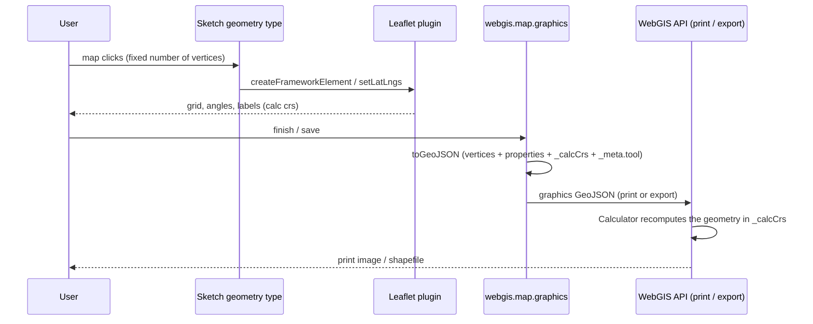
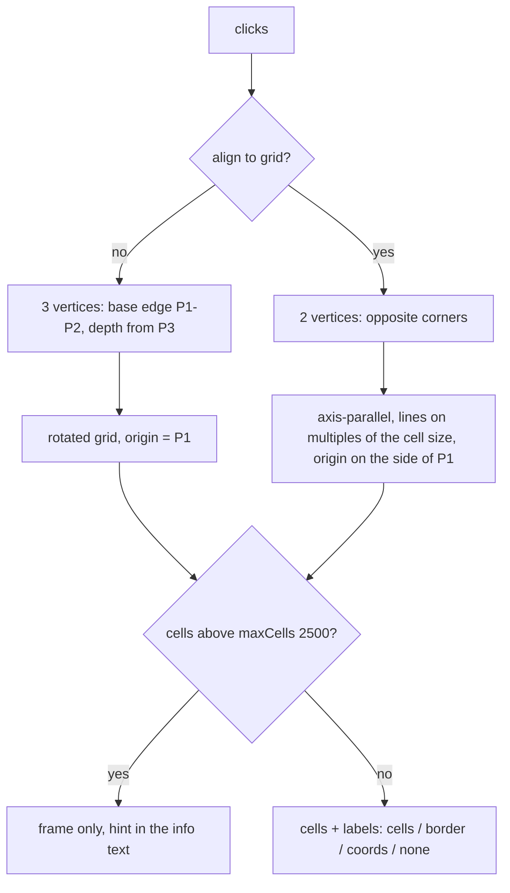
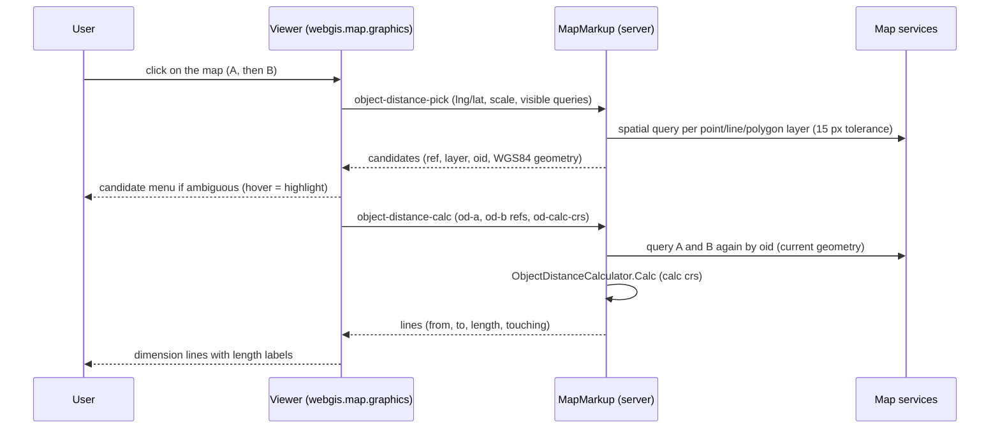
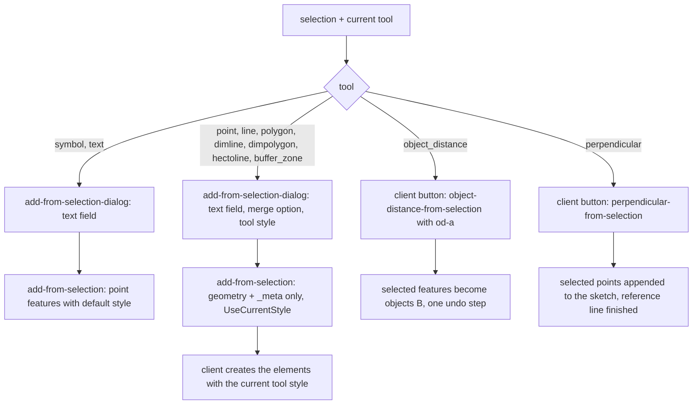

# MapMarkup Measure Tools

## Overview

The tool "Drawing (Map Markup)" has a group "Measure" (`ToolGroups` in `MapMarkup.cs`). Besides the
classic tools (distance circle, compass rose, dimension line/polygon, hectometer line) it contains
composite measure graphics: view angle, intersection angle, circle arc, perpendicular distance,
buffer zone, object distance and measurement grid ("Messgitter"). Each of them is one graphics
element that is constructed by a fixed sketch
procedure, drawn by a Leaflet plugin in the viewer, stored/loaded as GeoJSON, and redrawn on the
server for print and shapefile export with the **same geometry** as the client.

This doc describes the common pattern of all measure tools and the measurement grid in detail.

## Affected projects

| Project | Role |
|---------|------|
| `webgis-api` | Viewer JS (Leaflet plugins, sketch geometry types, graphics/UI wiring, l10n), print wiring in `RestMappingHelperService` |
| `E.Standard.WebGIS.Tools` | Server tool `MapMarkup`: tool buttons, tool groups, property UI elements, server commands, shapefile export |
| `E.Standard.WebMapping.Core` | Shared geometry calculators used by print and export (`MeasureGridCalculator`, `BufferZoneCalculator`, ...) |
| `E.Standard.WebMapping.GeoServices` | Print graphic elements (`*Element` classes) that draw the graphics into the print map |

## Key classes / files

| Class / file | Responsibility |
|--------------|----------------|
| `webgis-graphics.<tool>.js` (`src/NetCore/Web/Api/wwwroot/scripts/leaflet/plugins/`) | Leaflet framework element per tool (`L.ViewAngle`, `L.MeasureGrid`, ...): drawing, labels, `toGeoJSON`, optional `toPreviewGeoJSON` for the hover highlight in the graphics list |
| `webgis-graphics.view_angle.js` (`.../leaflet/plugins/`) | Shared helpers `L.ViewAngle.toCalc` (WGS84 to calc crs and back), `formatNumber`, angle helpers |
| `webgis.sketch.geometry.<tool>.js` (`src/NetCore/Web/Api/wwwroot/scripts/api/`) | Sketch geometry type (registered with `webgis.sketch.geometryTypes.define`): vertex count, construction, info text, framework element creation |
| `webgis.sketch.js`, `webgis.map.graphics.js` (`.../scripts/api/`) | Setters/getters of the tool properties, tool list, style types, GeoJSON save/load (`_meta.tool`) |
| `MapMarkup` (`src/NetStandard/E.Standard.WebGIS.Tools/MapMarkup/MapMarkup.cs`) | Tool buttons, group "measure", `On<Tool>ToolClick` handlers, server commands (e.g. `buffer-zone-calc`) |
| `UIElementExtensions` (`.../MapMarkup/Extensions/UIElementExtensions.cs`) | Property UI per tool (e.g. `AddMeasureGridStyleElements`) |
| `Mapping`, `ShapeFileExport` (`.../MapMarkup/Export/`) | Shapefile geometry type and attribute mapping per tool, special geometries (buffer polygon, arc, grid cells) |
| `RestMappingHelperService` (`src/NetCore/Web/Api/AppCode/Services/Rest/RestMappingHelperService.cs`) | Print: creates the graphic element per `_meta.tool` |
| `*Element` (`src/NetStandard/E.Standard.WebMapping.GeoServices/Graphics/GraphicElements/`) | Print drawing, e.g. `ViewAngleElement`, `BufferZoneElement`, `MeasureGridElement`, `ObjectDistanceElement`, `AngleElementHelper` |
| `*Calculator` (`src/NetStandard/E.Standard.WebMapping.Core/Geometry/`) | Server port of the client geometry: `MeasureGridCalculator`, `BufferZoneCalculator`, `CircleArcCalculator`, `ObjectDistanceCalculator` |
| `ShapeMerger` (`.../WebMapping.Core/Geometry/ShapeMerger.cs`) | "Add from selection" option "merge objects": polygon union, line joining, multipoint |

## Flow

### Measurement grid (`measure_grid`)

- Construction: `cols = ceil(length / cellWidth)`, `rows = ceil(depth / cellHeight)` (at least 1),
  so the grid always covers the drawn rectangle; cell names `A1`, `B1`, ... (columns `A..Z, AA, ...`).
- Label modes: `cells` (all cell names, or none if they don't fit at the current zoom), `border`
  (column/row names along the frame, thinned out), `coords` (grid line coordinates, aligned grids
  only, otherwise falls back to `border`), `none`.
- Origin editing: the X/Y of the origin (corner of A1) can be entered; the vertices are shifted in the
  calc crs (aligned grids: shift rounded to multiples of the cell size). Align mode, origin inputs and
  the `coords` option are hidden without a real calc crs (no crs or web mercator).
- Stored GeoJSON: LineString of the construction vertices with `stroke`, `stroke-width`,
  `stroke-style`, `font-size`, `mg-cell-width`, `mg-cell-height`, `mg-labels`, `mg-align`, `_calcCrs`.
- Print: `MeasureGridElement` (lines with dash style, labels in the line color with white halo, same
  label heuristic as the client).
- Shapefile export: one polygon per cell (`measure_grid.shp`) with `LABEL`, `COL`, `ROW`, `WIDTH`,
  `COLOR`, `CELL_W`, `CELL_H`, `ALIGN`; above `MaxCells` only the frame polygon. GeoJSON/GPX export
  the stored LineString unchanged (re-importable).

### Object distance (`object_distance`)

Shortest connection from one object A to any number of objects B (features of the map layers, any
geometry type incl. multipart). Unlike the other measure tools it is not constructed from clicked
vertices: the clicks only pick features, the geometry is calculated by the server.

- References: `"<theme-id>|<oid>"` (theme id from `bridge.GetQueryThemeId`), at most
  `ObjectDistanceMaxCandidatesPerLayer` (10) candidates per layer, ordered by distance to the click.
- Clicking A again is ignored, clicking an existing B again removes it (toggle).
- `ObjectDistanceCalculator`: polygons are treated as their boundary (a point inside a polygon gets the
  distance to the boundary); connections shorter than `TouchTolerance` mean "touching" (length 0, no line).
- Stored GeoJSON: MultiLineString of all connection lines with `od-a` and `od-lines` (JSON strings:
  refs, layer names, oids, lengths, end points; no feature geometries), `od-length-unit`,
  `od-show-number`, `_calcCrs`. Loaded elements are **not** recalculated (snapshot of the distances).
- Print: `ObjectDistanceElement` (line, end points, label parallel to the line, optional number);
  the highlights of A/B are sketch-only and not printed.
- Shapefile export: one polyline per connection line (`object_distance.shp`) with `NR`, `LENGTH_M`
  (always meters), `LAYER_A`, `OID_A`, `LAYER_B`, `OID_B`, `WIDTH`, `COLOR`; touching objects are
  skipped, `NR` stays the label number.

### Add from selection

When features are selected (query result selection) the Map Markup tool panel shows a button
"add from selection" for the matching tools (only if `allow-add-from-selection` is enabled). The
selection is sent with every tool request as `_selectioninfo` (`SelectionInfoDependent`).

- Draw/measure tools (`AddFromSelectionWithCurrentStyle`): the server only checks the geometry type
  (`FromSelectionAcceptsShape`) and returns geometry + `_meta`; the client applies the current style
  and tool options (`graphics.usecurrentstyle`), so the dialog shows the same style elements as the tool.
- "Merge objects" (`FromSelectionMergeTools`, more than one feature): `ShapeMerger.Merge` (polygon
  union, lines connected at their end points, points to a multipoint) in the calc crs.
- `dimline`/`hectoline`: multipart lines are split into one element per path; `dimpolygon`: one element
  per outer ring, holes are removed; both with an info message. `buffer_zone`: the buffer is calculated
  by the server (`FromSelectionBufferZoneFeature`).
- `object_distance` / `perpendicular` (sketch based, `SketchFromSelectionFeatures`): the client sends the
  current sketch state (A, existing B refs / nothing), the server answers with client commands
  (`setgraphicsobjectdistancelines` with `from_selection`, `setgraphicsperpendicularpoints`). The sketch
  adds everything as one undo step, skips duplicates (existing B, points closer than 1 cm) and zooms to
  the sketch only if it is outside the current map extent.

## Configuration

| Setting | Where | Default | Description |
|---------|-------|---------|-------------|
| `webgis.usability.groupToolOptions` | `custom.js` | `true` | Groups the Map Markup tools ("Draw", "Measure", "Import/Export"); `false` = flat list |
| `allow-add-from-selection` | `api.config` (tool `mapmarkup`) | `false` | Shows "add from selection" in the Map Markup tools |
| `allow-add-from-selection-max-features` | `api.config` (tool `mapmarkup`) | `0` (no limit) | Maximum number of selected features for "add from selection" |
| `allow-add-from-selection-max-vertices` | `api.config` (tool `mapmarkup`) | `0` (no limit) | Maximum number of vertices of all selected features |

The tool properties (cell size, labels, angles, units, ...) are user settings; the last entered
values are the default for further objects in the same session.

## Design decisions

- **Same geometry on client and server:** the server never trusts drawn coordinates of the derived
  geometry; it recomputes it from the construction vertices, the tool properties and `_calcCrs`
  (`*Calculator` classes mirror the JS `calc` functions). Exception: the buffer zone, whose buffer is
  calculated by the server anyway and stored with the element (`bz-buffer`).
- **Calc crs:** measurements are done in the calc crs of the map (meters), stored as `_calcCrs`;
  without a known calc crs a local equirectangular approximation is used (`L.ViewAngle.toCalc`,
  `MeasureGridCalculator`).
- **Sketch stays active** after the required vertices: further clicks replace the last vertex, so the
  properties can still be changed (like the distance circle).
- **Measurement grid:** rotated rectangle by 3 clicks instead of an arbitrary polygon (no clipping);
  "align to grid" and origin editing were added so grids can start at round coordinates.
  The cell limit (2500) protects the viewer and the print; the grid is not clipped or split.
- **Object distance on the server:** the features are queried again by reference and the distance is
  calculated server-side, so client geometries (generalized, clipped to the extent) are never used.
  The result is stored as a snapshot; reloading a drawing does not query the layers again.
- **Add from selection with the current style:** the server sends geometry only, the client applies the
  current tool style/options, so new elements look exactly like manually drawn ones.
- **Export:** GeoJSON keeps the original element (round trip), the shapefile gets the derived
  geometry that is useful in a GIS (cells, buffer polygon, arc).

## Pitfalls / things to watch

- Every change of a JS `calc` (e.g. `L.MeasureGrid.calc`) must be mirrored in the server calculator,
  otherwise print/export differ from the viewer. Test: draw, print and export the same element.
- A new tool must be added in many places: tool lists in `webgis.map.graphics.js` (tools, style
  types, load from GeoJSON), sketch setters/getters, `bundleconfig.json` and the Portal views,
  `MapMarkup.cs` (button, group, click handler, element-selected switch), `ApiClientButtonCommand`
  in `Enums.cs`, `UICss.cs`, l10n (server `l10n/{de,en}/Tools.MapMarkup.md`, client
  `webgis.l10n.{de,en}.js`), icon resource, `RestMappingHelperService`, `Mapping.cs`.
- Shapefile field names are limited to 10 characters; the export writes one shapefile per tool.
- Hovering in the graphics list should not render heavy geometries: use `toPreviewGeoJSON`
  (e.g. thinned-out buffer).
- Object distance: the server response of `object-distance-pick/-calc/-from-selection` is matched with
  `od-key`; responses of an outdated sketch must be ignored. Layers without a query theme id cannot be
  picked.
- Add from selection: the dialog is a modal dialog that re-centers itself (`fit`) when its content
  changes; new tools need an entry in `FromSelectionAcceptsShape` and the style switch of the dialog.

## Extension points

- New measure tool: Leaflet plugin + sketch geometry type (client), calculator + print element +
  export mapping (server), following the measurement grid as the most recent example.

## History

| Version | Change | Reference |
|---------|--------|-----------|
| `9.26.4104` | Doc created; new measure tool "Measurement grid" (`measure_grid`) | [Issue #486](https://github.com/e-netze/webgis-community/issues/486) |
| `9.26.4104` | Object distance (`object_distance`) incl. print and shapefile export | `bb903a71`, [Issue #486](https://github.com/e-netze/webgis-community/issues/486) |
| `9.26.4104` | Add from selection for all draw/measure tools (current style, merge), object distance and perpendicular | `1e28244e`, `1f8588ef` |
