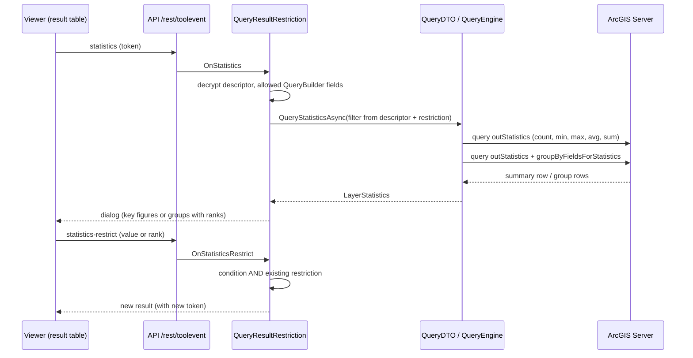
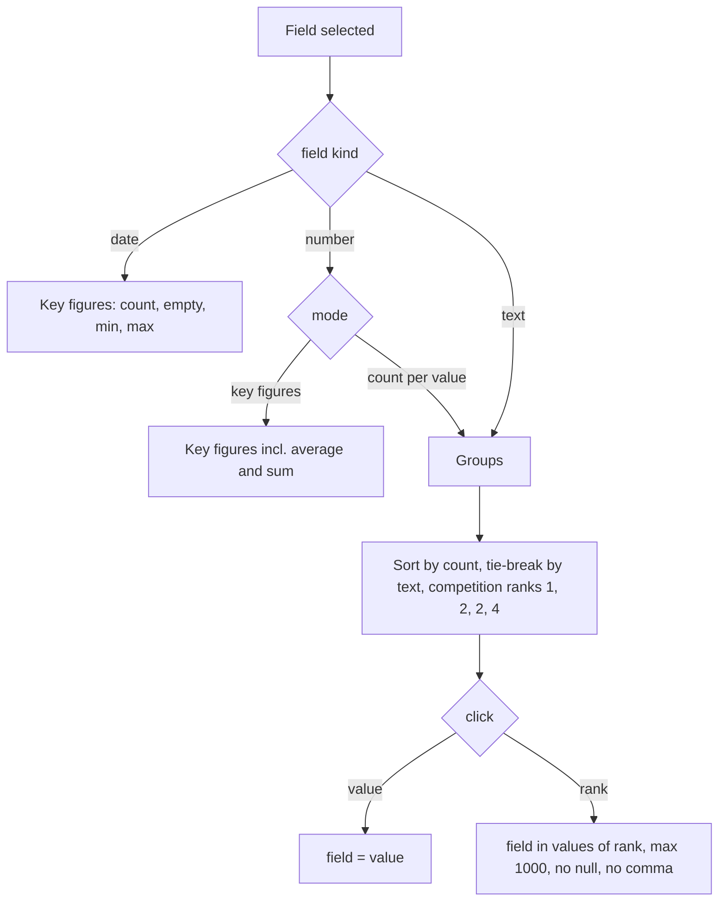

# Query Result Restriction & Statistics

## Overview

Query/identify results in the result table (desktop) can be narrowed down with the Query Builder
(table tool "Restrict") and analyzed with server-side field statistics (table tool "Statistics":
key figures, count per value with ranks, CSV download). Both re-run the **original query** on the
server - described by an encrypted token - so they cover all matching features, also when the
result table only shows a limited number of hits (`has_more`). Clicking a statistics value or rank
restricts the result directly. This is a result filter, not a display filter.

## Affected projects

| Project | Role |
|---------|------|
| `webgis-api` | Creates the `QueryRestrictionDescriptor` for query/identify/TOC-table results and adds it as token to the result metadata (`QueryRestrictionExtensions`); viewer JS (table tools, Query Builder rows, statistics dialog) and CSS |
| `E.Standard.Api.App` | `QueryDTO.QueryStatisticsAsync`, `QueryEngine` (`AdvancedQueryMethod.Statistics`), `FeaturesDTO.QueryRestrictionMeta` |
| `E.Standard.WebMapping.Core.Api` | `QueryRestrictionDescriptor` (token), `IQueryBridge.QueryStatisticsAsync` |
| `E.Standard.WebMapping.Core` | `ILayerStatisticsQuery`, statistics models (`LayerStatisticsRequest`, `LayerStatistics`, `LayerStatisticsGroup`, `LayerStatisticsFieldKind`) |
| `E.Standard.WebMapping.GeoServices` | ArcGIS Server `FeatureLayer` implements `ILayerStatisticsQuery` (`outStatistics`, `groupByFieldsForStatistics`); `supportsStatistics` from the layer JSON |
| `E.Standard.WebGIS.Tools` | Tool `QueryResultRestriction`: restrict, statistics, CSV and restrict-by-value commands |
| `E.Standard.WebGIS.Tools.Tests` | Unit tests of the statistics helpers (ranks, conditions, CSV) |

## Key classes / files

| Class / file | Responsibility |
|--------------|----------------|
| `QueryRestrictionDescriptor` (`src/NetStandard/E.Standard.WebMapping.Core.Api/Models/QueryRestrictionDescriptor.cs`) | Origin of a result (service/query id, effective query geometry as WKT, search items, original where, current restriction, limit); only sent to the client encrypted (`ToToken`/`FromToken`) |
| `QueryRestrictionExtensions` (`src/NetCore/Web/Api/AppCode/Extensions/QueryRestrictionExtensions.cs`) | `IsQueryRestrictable` (QueryBuilder allowed + allowed fields in the layer); `TrySetQueryRestriction` writes `metadata.query_restriction` (`token`, `where`, `statistics` if the layer supports statistics) |
| `RestQueryHelperService`, `RestToolsHelperService` (`src/NetCore/Web/Api/AppCode/Services/Rest/`) | Create/forward the descriptor for query, identify and TOC-table results |
| `FeaturesDTO.QueryRestrictionMeta` (`src/NetStandard/E.Standard.Api.App/DTOs/FeaturesDTO.cs`) | Metadata DTO `query_restriction` with the `statistics` flag |
| `QueryDTO.QueryStatisticsAsync` (`src/NetStandard/E.Standard.Api.App/DTOs/QueryDTO.cs`), `QueryEngine` (`.../E.Standard.Api.App/QueryEngine.cs`) | Builds the same filter as a feature query (geometry, items, where, locked filters) and calls `ILayerStatisticsQuery`; information messages (e.g. out of scale) become an `InfoException` |
| `ILayerStatisticsQuery` (`src/NetStandard/E.Standard.WebMapping.Core/Abstraction/ILayerStatisticsQuery.cs`), `LayerStatistics.cs` (`.../E.Standard.WebMapping.Core/Models/`) | Abstraction and models: total/null count, min/max/avg/sum, groups with value/label/count, `OtherFeaturesCount` |
| `FeatureLayer` (`src/NetStandard/E.Standard.WebMapping.GeoServices/ArcServer/Rest/FeatureLayer.cs`) | `QueryStatisticsAsync`: one `outStatistics` request for the key figures, one with `groupByFieldsForStatistics` for the groups; domain labels; dates as strings |
| `JsonLayer.SupportsStatisticsResolved` (`.../ArcServer/Rest/Json/JsonLayer.cs`) | `advancedQueryCapabilities.supportsStatistics` before the top-level flag, default `false` |
| `QueryResultRestriction` (`src/NetStandard/E.Standard.WebGIS.Tools/QueryResultRestriction.cs`) | Commands `restrict`, `remove-restriction`, `show-geometry`, `statistics`, `statistics-field`/`-mode`/`-sort`, `statistics-csv`, `statistics-restrict`; static helpers `StatisticsGroupRows` (competition ranks), `StatisticsGroupCondition`, `StatisticsRankCondition`, `CombineRestriction`, `StatisticsCsv` |
| `webgis.map.queryresults.js` (`src/NetCore/Web/Api/wwwroot/scripts/api/`) | Table tools "Restrict" and "Statistics" (only if `query_restriction.statistics`), restriction hint row |
| `webgis.ui.plugins.querybuilder.js`, `webgis.ui.builder.general.js` (`.../scripts/api/ui/`) | Removable Query Builder rows (×); menu items send `menuitem-item-command` from a clicked child with `data-item-command` (rank click) |
| `default.css` (`src/NetCore/Web/Api/wwwroot/content/styles/`) | `.webgis-statistics-*` styles (table, faded inherited rank, download button) |
| `Tools.QueryResultRestriction.md` (`src/NetCore/Web/Api/l10n/{de,en}/`) | Texts `statistics-*` incl. number culture (`statistics-culture`) |
| `QueryResultRestrictionStatisticsTests` (`src/NetStandard/E.Standard.WebGIS.Tools.Tests/Statistics/`) | Ranks asc/desc, conditions, limits, CSV quoting/injection |

## Flow

## Configuration

| Setting | Where | Default | Description |
|---------|-------|---------|-------------|
| QueryBuilder allowed + fields | CMS, service | - | Prerequisite for both tools; only these fields are offered |
| `supportsStatistics` | ArcGIS Server layer | - | Statistics tool only shown if reported `true` |
| `maxRecordCount` | ArcGIS Server service | - | Limits the number of returned groups ("further values" hint) |
| `MaxStatisticsRankValues` | constant in `QueryResultRestriction` | `1000` | Max. values for a rank restriction (`in` list) |

User docs: [Restricting a query result](https://docs.webgiscloud.com/en/webgis-manual/mapviewer/search_identify/operations/results_desktop/results_desktop.html#results-query-restriction),
[Statistics](https://docs.webgiscloud.com/en/webgis-manual/mapviewer/search_identify/operations/results_desktop/results_desktop.html#results-query-statistics),
[Admin restrictions (CMS)](https://docs.webgiscloud.com/en/webgis/apps/cms/add_ags_service.html#cms-ags-query-statistics).

## Design decisions

- **Encrypted descriptor token** instead of client-side query parameters: the client cannot change
  the query, geometry or locked parts; the server re-runs exactly the original query.
- **Server-side statistics** over the whole query instead of client-side aggregation of the loaded
  features: correct with result limits (`has_more`) and without loading all features.
- **ArcGIS only** (`ILayerStatisticsQuery`): other service types (WMS, WFS, ...) have no equivalent;
  the tool is hidden there instead of showing partial (client-side) numbers.
- **Competition ranks** ("1224"): equal counts share a rank, the next rank is skipped; a repeated
  rank is faded but still clickable. Default sort descending, so rank 1 is on top.
- **Rank click is recalculated on the server**: the client only sends the clicked value; the server
  queries the groups again and builds the `in` list of all values with the same count.
- **Restrictions are combined with AND**; single Query Builder rows can be removed to step back.
- **CSV is generated on the server** (same rows/sort as the dialog, `;` separator, UTF-8 BOM, values
  starting with `= + - @` (except numbers) are prefixed with `'` against CSV injection).

## Pitfalls / things to watch

- `supportsStatistics` must be read from `advancedQueryCapabilities` first; some servers report
  different values at the top level.
- The total count uses `count` on the id field (falls back to the field itself), the "empty" count
  is total minus `count(field)`.
- Groups are limited by the service's `maxRecordCount`; `OtherFeaturesCount` is derived from the
  total count, not from a second request.
- Rank conditions use an `in` list: values with commas cannot be parsed back by the Query Builder,
  `null` cannot be in a list, Oracle allows max. 1000 expressions - these throw an `InfoException`.
- Restrict-by-value is not allowed for date fields (server check, not only hidden in the UI).
- Minified bundles (`webgis-api.min.js/.css`) must be regenerated after JS/CSS changes.
- Test: `dotnet test` with filter `QueryResultRestrictionStatistics`, and manually in the viewer
  with an ArcGIS layer (text, number and date fields; result above the hit limit).

## Extension points

- Statistics for other service types: implement `ILayerStatisticsQuery` for the layer type and
  set `SupportsStatistics`.

## History

| Version | Change | Reference |
|---------|--------|-----------|
| `9.26.4104` | Result restriction with the Query Builder (token in `query_restriction`), TOC "Table" | `61ce54b2` |
| `9.26.4104` | Server-side statistics (key figures, count per value with ranks, restrict by value/rank, removable Query Builder rows, CSV) | `92f93fc4` |
