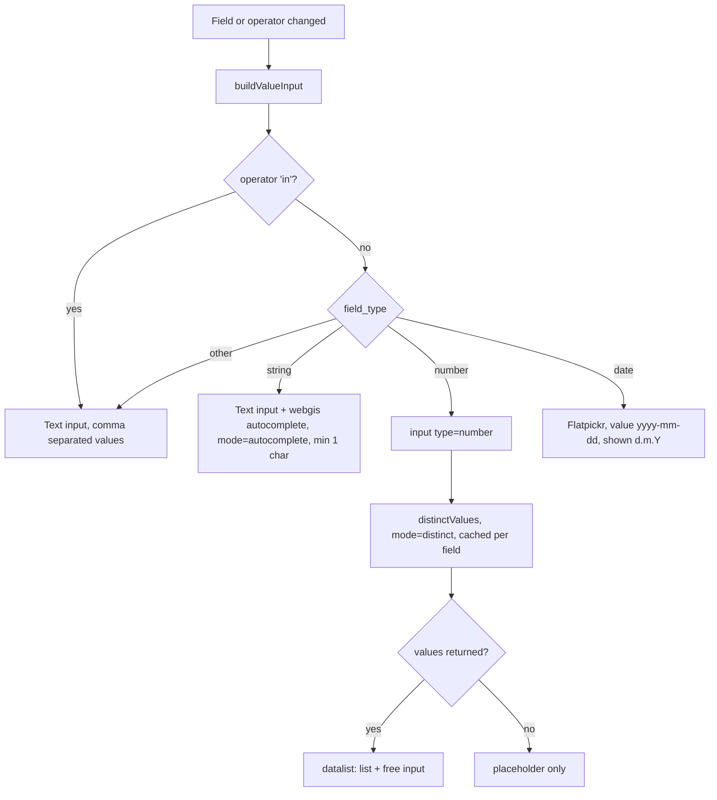
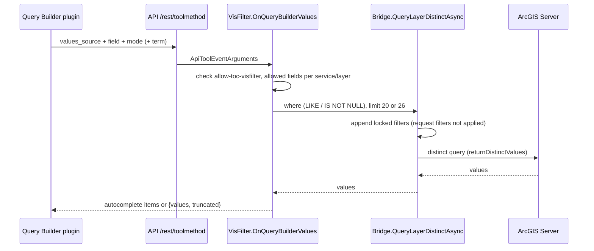

# Query Builder & Value Suggestions

## Overview

The Query Builder (`UIQueryBuilder`) builds simple SQL where clauses (field, operator, value, AND/OR).
It is used for TOC display filters (`VisFilter`) and the Edit desktop selection. The input for the
value depends on the field type. If the owning tool provides a values source, the builder also
suggests values that are queried live from the service: autocomplete for strings, a list for
numbers with few distinct values, and a date picker for dates.
The same distinct-value query also backs the user renderer ("Load values", "Calculate classes"),
so this doc also covers how filters are applied to distinct queries.

## Affected projects

| Project | Role |
|---------|------|
| `E.Standard.WebMapping.Core.Api` | `UIQueryBuilder` model: field types, operators, where clause tokenizer/parser, thresholds; `IBridge.QueryLayerDistinctAsync` |
| `E.Standard.WebGIS.Tools` | `VisFilter` (values source + `querybuilder-values` command), `UserRenderer` (distinct values with request filters), date value validation, debug demo |
| `E.Standard.Api.App` | `Bridge.QueryLayerDistinctAsync`: distinct query including locked/request filters |
| `E.Standard.WebMapping.GeoServices` | ArcGIS Server `FeatureLayer` implements `ILayerDistinctQuery` (only supported service type) |
| `webgis-api` | Viewer JS: Query Builder builder/plugin, renderer editor, l10n |

## Key classes / files

| Class / file | Responsibility |
|--------------|----------------|
| `UIQueryBuilder` (`src/NetStandard/E.Standard.WebMapping.Core.Api/UI/Elements/Advanced/UIQueryBuilder.cs`) | Fields with `field_type` (`string`/`number`/`date`/`boolean`/`unknown`) and type-specific operators; `ValuesSource` (`values_source`); constants `AutocompleteMaxValues` (20), `MaxDistinctComboValues` (25), `DateValueTemplate` (`DATE '{0}'`); tokenizer understands `DATE`/`TIMESTAMP` literals (prefill of existing filters) |
| `VisFilter` (`src/NetStandard/E.Standard.WebGIS.Tools/Presentation/VisFilter.cs`) | Sets `ValuesSource` via `UIInputAutocomplete.MethodSource(...)` with the URL-escaped `qb_request`; `OnQueryBuilderValues` (`querybuilder-values`): checks `allow-toc-visfilter`, only allowed QueryBuilder fields, `mode=autocomplete` (`UPPER(field) LIKE '%term%'`) or `mode=distinct` |
| `ApiToolEventArgumentsExtensions` (`src/NetStandard/E.Standard.WebGIS.Tools/Editing/Extensions/ApiToolEventArgumentsExtensions.cs`) | Validates date values (`yyyy-MM-dd`) before they are put into a `DATE` literal |
| `IBridge.QueryLayerDistinctAsync` (`src/NetStandard/E.Standard.WebMapping.Core.Api/Bridge/IBridge.cs`), `Bridge` (`src/NetStandard/E.Standard.Api.App/Bridge.cs`) | Distinct values of a field (`ILayerDistinctQuery`); always appends the locked filters, request filters (TOC + CMS) only with `applyRequestVisFilters: true` (`GetFilterDefinitionQuery(service, layerId, includeRequestFilters)`) |
| `UserRenderer` (`src/NetStandard/E.Standard.WebGIS.Tools/Presentation/UserRenderer.cs`) | `distinct_values` / `field_range` call the distinct query with `applyRequestVisFilters: true`; `[AdvancedToolProperties(VisFilterDependent = true)]` |
| `DebugUIAdvancedSelectors` (`src/NetStandard/E.Standard.WebGIS.Tools/Debug/UI/DebugUIAdvancedSelectors.cs`) | DEBUG demo of the Query Builder with a fake values source |
| `webgis.ui.builder.querybuilder.js`, `webgis.ui.plugins.querybuilder.js` (`src/NetCore/Web/Api/wwwroot/scripts/api/ui/`) | Builder passes `values_source`; plugin `buildValueInput` / `releaseValueInput` / `distinctValues` (per-field cache) |
| `webgis.ui.plugins.renderereditor.js` (`.../scripts/api/ui/`) | Sends `visfilter_dependent: true` for the ad-hoc `distinct_values` / `field_range` tool calls |
| `webgis.l10n.de.js` / `webgis.l10n.en.js` (`.../scripts/api/`) | Placeholders `querybuilder-enter-text`, `-enter-number`, `-enter-date`, `-enter-values-comma` |

## Flow

With more than 25 distinct values, `values` is still returned but `truncated` is set and
the client shows only the number input with a placeholder (no list).

## Configuration

| Setting | Where | Default | Description |
|---------|-------|---------|-------------|
| `allow-toc-visfilter` | `api.config` section `toc-contextmenu` | `false` | Enables the TOC Query Builder and the `querybuilder-values` command |
| `webgis.usability.allowTocVisFilters` | `custom.js` | `false` | Shows the Query Builder in the viewer |
| QueryBuilder fields | CMS, service | - | Only these fields are offered and accepted for suggestions |
| `AutocompleteMaxValues`, `MaxDistinctComboValues` | constants in `UIQueryBuilder` | `20`, `25` | Thresholds (not configurable on purpose) |

User docs: [Query Builder](https://docs.webgiscloud.com/en/webgis-manual/mapviewer/presentation/index.html#toc-querybuilder),
[api.config `toc-contextmenu`](https://docs.webgiscloud.com/en/webgis/config/api/index.html#api-config-toc-contextmenu).

## Design decisions

- **Live values, ArcGIS only**: values are queried on demand via `ILayerDistinctQuery`, which is
  only implemented by the ArcGIS Server `FeatureLayer`. Other services fall back to typed inputs
  without suggestions. Other sources can be added by implementing the interface.
- **Suggestions ignore the active display filter** (only locked filters apply), so an existing
  filter can be widened. The user renderer instead applies the request filters, because its
  classes should describe the visible features.
- **Locked filters always apply** to distinct queries. Otherwise a user could read values that are
  hidden by a locked CMS filter.
- **Strings use "contains"** (`UPPER(field) LIKE '%term%'`) from one character on, at most 20 values.
- **Numbers use `input type=number` with a `datalist`** instead of a real combo, so free input is
  always possible. The list is shown only for at most 25 distinct values (one value more is
  queried to detect truncation).
- **Dates use the existing Flatpickr** (`webgis.require('flatpickr')`) right away instead of a
  plain text field as an interim step. `=` produces `DATE 'yyyy-mm-dd'`.
- **Thresholds are constants**, not `api.config` settings.
- The Edit desktop Query Builder gets the typed inputs, but no suggestions (no values source).

## Pitfalls / things to watch

- **Autocomplete collects siblings**: `webgis._appendAutocomplete` sends all `.webgis-input`
  elements of the container as parameters. That's why the value input sits in its own
  `.webgis-query-builder-value-container` and is named `querybuilder_value`.
- **`MethodSource` does not URL-encode parameters**: the JSON `qb_request` must be wrapped in
  `Uri.EscapeDataString`, otherwise the values URL breaks.
- **Cache entries need an explicit shape**: `distinctValues` stores `{values, callbacks}`. A check
  like `cache[f].values !== undefined` on an array is always true (`Array.prototype.values`).
- **Ad-hoc tool objects need `visfilter_dependent`**: the renderer editor calls tools with
  hand-built tool objects. Without `visfilter_dependent: true`, `map.appendRequestParameters`
  does not send the `filters` parameter and the server cannot apply the display filters.
- **Date literals in the tokenizer**: `DATE '...'` / `TIMESTAMP '...'` must stay one token,
  otherwise existing date filters cannot be pre-filled (see `WhereParserTests`).
- **Release inputs**: `releaseValueInput` must destroy Flatpickr and typeahead instances before the
  container is emptied (field/operator change, row removal).
- Test: DEBUG tool "Advanced Selectors" (Query Builder demo), `E.Standard.WebMapping.Core.Api.Tests`
  (`WhereParserTests`), and manually in the viewer with an ArcGIS layer with string/number/date fields.

## Extension points

- New value sources: implement `ILayerDistinctQuery` for a layer type.
- New field types: map them in `UIQueryBuilder` (`FieldDef.ValueType`, operators, value template)
  and add a branch in `buildValueInput`.

## History

| Version | Change | Reference |
|---------|--------|-----------|
| `9.26.4104` | Value suggestions (autocomplete, number list, date picker), date operators; locked/request filters for distinct queries (user renderer respects display filters) | branch `v9-querybuilder` |
