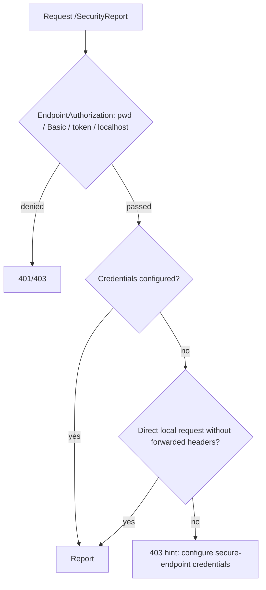

# Security Report

## Overview

The security report is a page in the WebGIS API that lists all security-relevant `api.config` keys with their
current value, default, category, risk and a traffic light for an **internet** and an **intranet**
installation (side by side, no profile switch). It helps admins to find settings that deviate from the
recommendations of the Security annex of the admin documentation. It is deliberately **independent of the
subscriber login**, because the login is disabled on hardened internet instances (`allow-subscriber-login=false`).

## Affected projects

| Project | Role |
|---------|------|
| `webgis-api.csproj` | Controller, view, rules, startup log, subscriber 2FA overview |
| `E.Standard.WebApp` | `EndpointAuthorizationAttribute` / middleware, `SecurityOptions` (secure-endpoint credentials) |

## Key classes / files

| Class / file | Responsibility |
|--------------|----------------|
| `SecurityReportRules` (`AppCode/Services/Security/SecurityReportRules.cs`) | **Single place** with all rules (key, default, category, risk, annex anchor, evaluator per profile) |
| `SecurityReportModels` (`AppCode/Services/Security/SecurityReportModels.cs`) | `SecurityRule`, `SecurityRuleContext` (raw config access), verdict/status enums, `SecurityReport` |
| `SecurityReportService` | Evaluates the rules against `ConfigurationService`; secrets are never copied into the model |
| `SecurityReportStartupService` | `IHostedService`; logs a summary of findings (category `WebGIS.Security.Audit`) |
| `SecurityReportController` | Route `/SecurityReport`, access control (see below) |
| `Views/SecurityReport/Index.cshtml` | Table + summary + legend; links rows to the annex |
| `Views/Subscribers/index.cshtml` | Admin tile with a bearer token linking to the report |

## Flow

Evaluation: each rule returns a verdict per profile (`Ok`, `Deviation`, `Hint`, `NotApplicable`). A `Deviation` becomes
**red** for risk *High*, **yellow** for *Medium* and a grey hint for *Low/Info*. Rules with `requiresLogin` are *not applicable*
when `allow-subscriber-login` is not `true`.

## Configuration

No own setting. The report evaluates the existing keys (see the annex table). Access uses
`security:secure-endpoint-url-password` / `security:secure-endpoint-basicauth-*`.

Admin docs: <https://docs.webgiscloud.com/en/webgis/annex/security.html#annex-security-keys>

## Design decisions

- **Both profiles side by side** instead of a `deployment-profile` key or selector: no extra setting, no wrong profile.
- **Own endpoint instead of the subscriber admin**, because the login may be disabled. Access: secure-endpoint credentials
  or direct localhost; a startup log summary exists for admins who never open the page.
- **Fail-closed:** `EndpointAuthorizationMiddleware` lets `UrlPassword`/`Basic` pass when no credentials are configured
  (`"" == ""`). The controller therefore rejects remote requests itself if no credentials are configured.
- Localhost means loopback/own address **and** no `X-Forwarded-*`/`Forwarded`/`X-Real-IP` header (reverse proxy on the same host).
- Rules in code, not in config: kept in sync with the docs table **manually**.
- Phase 1: only `api.config`. Portal and CMS keys get their own reports later.

## Pitfalls / things to watch

- Changing a recommendation, risk or category in the annex table requires the same change in `SecurityReportRules` (and vice versa).
- A reverse proxy on the same host that sends **no** forwarded headers looks like loopback and would grant localhost access.
- Secrets/connection strings must stay `Secret = true` (shown as set / not set only).
- The subscriber-admin tile creates a bearer token; without configured credentials a remote admin still gets the 403 hint.

## Extension points

- New key: add a `Rule(...)` in `SecurityReportRules` and the matching row to the annex table; UI text is hardcoded German (admin page, no l10n in v8; l10n follows in v9), the audit log (`WebGIS.Security.Audit`) stays English.

## History

| Version | Change | Reference |
|---------|--------|-----------|
| 8.x | Security report page introduced | - |
