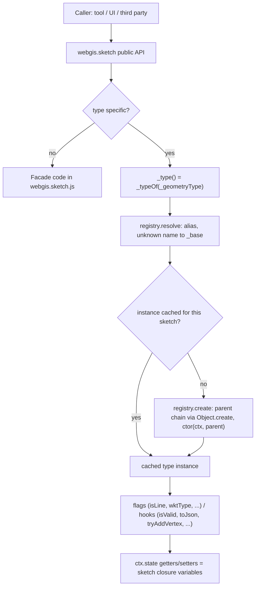

# Sketch Geometry Types

## Overview

`webgis.sketch` is the viewer's drawing/editing object for all sketch geometries (point, line,
polygon, rectangle, circle, text, dimensioning, ...). It is used by many tools and by third-party
code, so its public API (`this.<function>`, including the `_`-prefixed ones) is stable.
The geometry-type specific behavior is not implemented with `if (_geometryType === ...)` branches
inside the sketch anymore, but in one file per geometry type, registered in a small registry.
`webgis.sketch` is a facade that keeps the API and delegates to the current geometry type.

## Affected projects

| Project | Role |
|---------|------|
| `webgis-api` | Hosts the viewer scripts (`wwwroot/scripts/api`) and the bundle definition (`bundleconfig.json`). |
| `webgis-portal` | Loads the single (unbundled) script files in debug views. |

## Key classes / files

| Class / file | Responsibility |
|--------------|----------------|
| `webgis.sketch` (`src/NetCore/Web/Api/wwwroot/scripts/api/webgis.sketch.js`) | Facade with the public API, closure state (vertices, parts, framework elements, styles), map/marker events, undo. Delegates type specific parts via `_type()` / `_typeOf(name)`. |
| `webgis.sketch.vertices` (`.../webgis.sketch.vertices.js`) | Type-independent vertex model: owns the flat vertex array and the part start indices (private) and does all pure vertex calculations. Parts (`count`, `start`, `end`, `partOf`, `partNumber`, `partVertices`, `isClosed`, ...), reads (`collect`, `allHaveProperty`, `neighbors`, `indicesInBounds`, `toLatLngs`), selection/fix (`select`, `selectAll`, `hasSelected`, `firstSelectedIndex`, `fix`, `isMovable`), move/rotate (`translate`, `rotate`, `translateLatLngs`, `rotateLatLngs` for the preview) and changes (`clear`, `setVertices`, `setPartIndex`, `removeVertex`, `closePart`, `snapshot`) plus static helpers (`partOf`, `isFirstPartVertex`, `reversedPartIndex`, `copyVertex`). No events, undo, markers or map access. |
| `webgis.sketch.geometryTypes` (`.../webgis.sketch.geometry.js`) | Registry: `define(name, baseName, ctor)`, `alias(alias, name)`, `resolve(name)`, `create(name, ctx)`. |
| `_base`, `_line`, `_polygon`, `_radius` (`.../webgis.sketch.geometry.base.js`) | Defaults for all flags and hooks plus shared helpers (json import); the families `_line` (polyline, dimline, hectoline), `_polygon` (polygon, dimpolygon), `_radius` (circle, distance_circle, compass_rose). |
| `.../webgis.sketch.geometry.<type>.js` | One file per type: `point`, `polyline` (+ alias `linestring`), `polygon`, `freehand`, `rectangle`, `text`, `circle`, `distance_circle`, `compass_rose`, `dimline`, `dimpolygon`, `hectoline`, `elementseries`. |
| `webgis.sketch.markers` (`.../webgis.sketch.markers.js`) | Vertex marker events (drag, click, mouseover/-out, GPS accuracy reset, click tolerance) and the marker popup menu; used by `_appendMarkerEvents` and `setMarkerTooltip`. Creating/redrawing the markers stays in the facade. |
| `webgis.sketch.style` (`.../webgis.sketch.style.js`) | Style values (color, fill, opacity, weight, line style, text color/style/size) per `styleIndex` of the geometry type, plus the line style <=> `dashArray` conversion. The facade keeps `get<Value>/set<Value>` as delegates and applies the values with `setStyle`. |
| `webgis.sketch.wkt` (`.../webgis.sketch.wkt.js`) | Static WKT export of the vertex model: `toWKT(model, typeDef, useWGS84, fanMode)`, `toWKT2(model, wktType, useWGS84, appendMeta, digits)`, `vertex(...)`. |
| `webgis.sketch.transform` (`.../webgis.sketch.transform.js`) | Move/rotate session of the whole sketch (or the selected vertices): state, gray preview polylines, apply via the vertex model (`translate`, `rotate`, `*LatLngs`). Used by `startSketchMoving`, `moveSketchPreview`, `moveSketch`, `...Rotating`, `_referenceVertex`. Calls other sketch methods via `sketch.` (e.g. `sketch.endSketchRotating()`), so overrides still apply. |
| `webgis.sketch.mover` (`.../webgis.sketch.mover.js`) | Visual mouse feedback only: mover line (green, red if `maxBBox` is exceeded), mover marker with snapping (`_showMoveMarker`), yellow construct line along the snapped edge, blue trace line. The decisions (when to show what) stay in the input handlers. `sketch._moverLine`, `_moverMarker`, `_constructMover` and `_snappedVertex` stay public sketch properties. |
| `src/NetCore/Web/Api/bundleconfig.json` | Bundle order: `webgis.sketch.js`, `webgis.sketch.vertices.js`, `webgis.sketch.markers.js`, `webgis.sketch.style.js`, `webgis.sketch.wkt.js`, `webgis.sketch.transform.js`, `webgis.sketch.mover.js`, then `webgis.sketch.geometry.js`, `...base.js`, then the type files. |
| `src/NetCore/Web/Portal/Views/Map/Index.cshtml`, `.../MapBuilder/Index.cshtml` | Same file list for the unbundled (debug) case. |

## Flow

## Configuration

None. Geometry types are selected at runtime via `sketch.setGeometryType(name)`.

## Design decisions

- **Facade, not subclasses**: `webgis.sketch` stays one object with the unchanged public API
  (same functions, same parameters), because it is used heavily by tools and third parties.
  Only the internals are delegated.
- **One instance per sketch and type**: type instances are created lazily and cached in the sketch
  (`_geometryTypeInstances`); switching the geometry type just resolves another instance.
- **State via getters/setters**: type instances get `ctx = { sketch, state, typeOf(name), type() }`; `state` exposes the
  sketch's closure variables via accessors, so types never own a copy of the state.
- **Sketch components with one-line delegates**: larger type-independent parts of the facade live in
  their own component (`webgis.sketch.markers`, ...), created once per sketch with the same `ctx`.
  The facade keeps every public `this.x = function (...)` with unchanged parameters as a one-line
  delegate, so the whole API stays visible in `webgis.sketch.js`.
- **Families via prototype chain**: `define(name, baseName, ...)` builds the instance with
  `Object.create(parent)`; the ctor receives `parent` to call the base implementation.
- **Hooks with "not handled" return values**: e.g. `tryAddVertex` / `handleMapMouseMove` return
  `false` and `cloneGraphicElements` returns `null` to fall back to the facade's default behavior.
- **Deliberately kept behavior** (documented in code): types without `wktType` write no WKT prefix
  (server `ShapeFromWKT` ignores it); `toJson` is only implemented for point, polyline and polygon;
  `elementseries.isValid` is always `false` (the map series sketch is never printed/downloaded).
- **Rendering by the types**: the type creates the framework elements (leaflet layers) for the
  vertex model via the hooks `render(model)` (all elements, used by `setGeometryType`/`redraw`),
  `renderAddedVertex(model, elements, currentIndex, vertex)` (returns the current element index) and
  `renderAppendPart(model, elements, latLngs)` (returns the elements). The facade only adds/removes the
  elements to/from the map. Default (`_base`): one element per part, in fan mode one element per ray.
  Elements are recreated on every `render` (as before), there is no element reuse.
- **Polygon holes via one multi-ring element**: `polygon` renders all parts as rings of one `L.polygon`
  (SVG `fill-rule: evenodd` => inner rings are holes, consistent with `calcProperties`/
  `webgis.calc.isRingsHole`); fan mode uses the default rendering. Markers and vertex indices
  are independent of the elements. `dimpolygon` (`L.DimPolygon`) supports only one ring and keeps one
  element per part.
- **Vertex model owned by the sketch, not by the types**: vertices and part starts live in one
  `webgis.sketch.vertices` instance (`_model` in the facade). The facade keeps `_vertices` only as a
  read-only alias of `_model.vertices`; the part index is private, all part arithmetic and pure vertex
  calculations (selection, fix, move, rotate, latLngs) go through the model. The facade keeps events,
  undo, markers, map access and usability flags (e.g. `allowSelectSketchVertices`). Types access it via
  `state.vertices` (getter) and `state.model`. Rejected: vertices per
  geometry type (switching types and `_getRawVertices` would need a shared array anyway).
- **Stable vertex array**: the array is always changed in place and never replaced, so
  `_getRawVertices()` (used by `webgis.sketch.ui.js`, `webgis.sketch.construct.tools.js` and third
  parties) returns the same reference for the whole sketch lifetime. `reverse`/`mergeParts` copy
  the vertices before `remove(true)`.

## Pitfalls / things to watch

- **Never reassign `state.vertices`**: there is no setter; change parts via `state.model`
  (`clear`, `setVertices`, ...). Other state values (e.g. framework elements) are still reassigned
  by the sketch, so never cache them in a type instance.
- **The part index may not start with `0`** (e.g. old stored sketches). `partNumber` (used by
  `getVertexPartNumber`/`neighbors`) keeps the original loop for this case; do not replace it with
  `partOf` without checking. `addPrevVertex(index <= 0)` is a no-op (it used to shift all part starts).
- **`reverse`/`mergeParts` empty the model before `remove(true)`**, otherwise `remove` fires an
  additional `ongetsinvalid` event.
- **Registry lookup is case-sensitive**; `setGeometryType` lowercases and maps `symbol` to point,
  `line`/`linestring`/`multilinestring` to polyline, and `multipoint` to elementseries only if
  elementseries is active.
- **Unknown types resolve to `_base`**: its `createFrameworkElement` returns `undefined`, so the
  first `_addToMap` throws. This is intended (programming error surfaces loudly, same as before).
- **Script order**: the registry and `base.js` must be loaded after `webgis.sketch.js` and before the
  type files - in `bundleconfig.json` and both Portal views.
- **Freehand** has no vertex marker for every vertex (`_vertexFrameworkElements` is sparse).
- **Framework element count != part count**: a polygon has one element for all parts. Never index
  `_frameworkElements` by part number (e.g. `swapDirection` limits the index to the element count).
- **Leaflet multi-ring pitfalls**: `L.Polygon.addLatLng(latLng)` without a ring adds to the *first*
  ring => pass the last ring (`getLatLngs()` returns the internal arrays). Never `setLatLngs([[]])`
  (treated as flat, crashes); `[]` and `[[a, b, c], []]` are fine.
- **`setGeometryType` empties `_frameworkElements` before `render`**: `createFrameworkElement` reads
  e.g. the radius via `sketch.getDistanceCircleRadius()` from the current element.
- **Testing**: there is no automated test for the sketch; verify drawing, editing (drag, insert,
  remove vertex, undo), json/WKT import/export and print for every type after changes.

## Extension points

- New geometry type: create `webgis.sketch.geometry.<type>.js` with
  `webgis.sketch.geometryTypes.define('<type>', '<_base|_line|_polygon|_radius>', function (ctx, parent) { ... })`,
  override only the needed flags/hooks, and register the file in `bundleconfig.json` and both Portal views.
- Type specific values (radius, unit, text, ...): set the default in the type ctor (`this.radius = 0;`) and declare
  the framework element accessors in `this.elementOptions = { radius: ['getRadius', 'setRadius'] }`; the facade
  getters/setters (`getCircleRadius`, ...) call `_typeOf('<type>').getOption/setOption('<name>')`, which sync the
  value with the current framework element.
- Alternative names: `webgis.sketch.geometryTypes.alias('<alias>', '<type>')`.

## History

| Version | Change | Reference |
|---------|--------|-----------|
| `9.26.4104` | Split geometry-type specific logic from `webgis.sketch.js` into a registry and one file per type; fixed several sketch quirks. | branch `v9-sketch` |
| `9.26.4104` | Polygon sketch draws inner parts as holes (fill element with all rings). | branch `v9-sketch` |
| `9.26.4104` | Vertices/part index moved into the vertex model `webgis.sketch.vertices` (stable vertex array) incl. selection, fix, move and rotate calculations. | branch `v9-sketch` |
| `9.26.4104` | Vertex marker events and popup menu moved into the component `webgis.sketch.markers`. | branch `v9-sketch` |
| `9.26.4104` | Types render their framework elements (`render`, `renderAddedVertex`, `renderAppendPart`); polygon draws all parts as rings of one element, the fill element was removed. | branch `v9-sketch` |
| `9.26.4104` | Style values moved into the component `webgis.sketch.style`; type specific getters/setters use the declarative `elementOptions` with `getOption`/`setOption`. | branch `v9-sketch` |
| `9.26.4104` | WKT export moved into the static module `webgis.sketch.wkt`; `statPoint` calculation moved into the vertex model. | branch `v9-sketch` |
| `9.26.4104` | Move/rotate sketch sessions moved into the component `webgis.sketch.transform`. | branch `v9-sketch` |
| `9.26.4104` | Mover line/marker, snapping marker, construct and trace line moved into the component `webgis.sketch.mover`. | branch `v9-sketch` |
