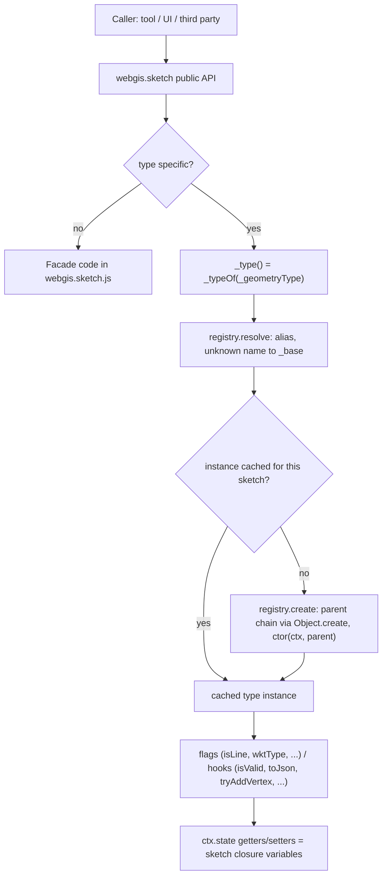

# Sketch Geometry Types

## Overview

`webgis.sketch` is the viewer's drawing/editing object for all sketch geometries (point, line,
polygon, rectangle, circle, text, dimensioning, ...). It is used by many tools and by third-party
code, so its public API (`this.<function>`, including the `_`-prefixed ones) is stable.
The geometry-type specific behavior is not implemented with `if (_geometryType === ...)` branches
inside the sketch anymore, but in one file per geometry type, registered in a small registry.
`webgis.sketch` is a facade that keeps the API and delegates to the current geometry type.

## Affected projects

| Project | Role |
|---------|------|
| `webgis-api` | Hosts the viewer scripts (`wwwroot/scripts/api`) and the bundle definition (`bundleconfig.json`). |
| `webgis-portal` | Loads the single (unbundled) script files in debug views. |

## Key classes / files

| Class / file | Responsibility |
|--------------|----------------|
| `webgis.sketch` (`src/NetCore/Web/Api/wwwroot/scripts/api/webgis.sketch.js`) | Facade with the public API, closure state (vertices, parts, framework elements, styles), map/marker events, undo. Delegates type specific parts via `_type()` / `_typeOf(name)`. |
| `webgis.sketch.vertices` (`.../webgis.sketch.vertices.js`) | Type-independent vertex model: owns the flat vertex array and the part start indices (private) and does all pure vertex calculations. Parts (`count`, `start`, `end`, `partOf`, `partNumber`, `partVertices`, `isClosed`, ...), reads (`collect`, `allHaveProperty`, `neighbors`, `indicesInBounds`, `toLatLngs`), selection/fix (`select`, `selectAll`, `hasSelected`, `firstSelectedIndex`, `fix`, `isMovable`), move/rotate (`translate`, `rotate`, `translateLatLngs`, `rotateLatLngs` for the preview) and changes (`clear`, `setVertices`, `setPartIndex`, `removeVertex`, `closePart`, `snapshot`) plus static helpers (`partOf`, `isFirstPartVertex`, `reversedPartIndex`, `copyVertex`). No events, undo, markers or map access. |
| `webgis.sketch.geometryTypes` (`.../webgis.sketch.geometry.js`) | Registry: `define(name, baseName, ctor)`, `alias(alias, name)`, `resolve(name)`, `create(name, ctx)`. |
| `_base`, `_line`, `_polygon`, `_radius` (`.../webgis.sketch.geometry.base.js`) | Defaults for all flags and hooks plus shared helpers (json import); the families `_line` (polyline, dimline, hectoline), `_polygon` (polygon, dimpolygon), `_radius` (circle, distance_circle, compass_rose). |
| `.../webgis.sketch.geometry.<type>.js` | One file per type: `point`, `polyline` (+ alias `linestring`), `polygon`, `freehand`, `rectangle`, `text`, `circle`, `distance_circle`, `compass_rose`, `dimline`, `dimpolygon`, `hectoline`, `elementseries`. |
| `src/NetCore/Web/Api/bundleconfig.json` | Bundle order: `webgis.sketch.js`, `webgis.sketch.vertices.js`, then `webgis.sketch.geometry.js`, `...base.js`, then the type files. |
| `src/NetCore/Web/Portal/Views/Map/Index.cshtml`, `.../MapBuilder/Index.cshtml` | Same file list for the unbundled (debug) case. |

## Flow

## Configuration

None. Geometry types are selected at runtime via `sketch.setGeometryType(name)`.

## Design decisions

- **Facade, not subclasses**: `webgis.sketch` stays one object with the unchanged public API
  (same functions, same parameters), because it is used heavily by tools and third parties.
  Only the internals are delegated.
- **One instance per sketch and type**: type instances are created lazily and cached in the sketch
  (`_geometryTypeInstances`); switching the geometry type just resolves another instance.
- **State via getters/setters**: type instances get `ctx = { sketch, state }`; `state` exposes the
  sketch's closure variables via accessors, so types never own a copy of the state.
- **Families via prototype chain**: `define(name, baseName, ...)` builds the instance with
  `Object.create(parent)`; the ctor receives `parent` to call the base implementation.
- **Hooks with "not handled" return values**: e.g. `tryAddVertex` / `handleMapMouseMove` return
  `false` and `cloneGraphicElements` returns `null` to fall back to the facade's default behavior.
- **Deliberately kept behavior** (documented in code): types without `wktType` write no WKT prefix
  (server `ShapeFromWKT` ignores it); `toJson` is only implemented for point, polyline and polygon;
  `elementseries.isValid` is always `false` (the map series sketch is never printed/downloaded).
- **Polygon holes via fill element**: each part is its own framework element (editing, markers and
  indices stay per part). For types with `hasFillElement` (only `polygon`) the parts draw only the
  outline and the facade draws the fill with one extra element containing all rings
  (`createFillElement`, SVG `fill-rule: evenodd` => inner rings are holes, consistent with
  `calcProperties`/`webgis.calc.isRingsHole`). Rejected: one multi-ring element for all parts
  (would change the part/element mapping everywhere). `dimpolygon` (`L.DimPolygon`) supports only one ring.
- **Vertex model owned by the sketch, not by the types**: vertices and part starts live in one
  `webgis.sketch.vertices` instance (`_model` in the facade). The facade keeps `_vertices` only as a
  read-only alias of `_model.vertices`; the part index is private, all part arithmetic and pure vertex
  calculations (selection, fix, move, rotate, latLngs) go through the model. The facade keeps events,
  undo, markers, map access and usability flags (e.g. `allowSelectSketchVertices`). Types access it via
  `state.vertices` (getter) and `state.model`. Rejected: vertices per
  geometry type (switching types and `_getRawVertices` would need a shared array anyway).
- **Stable vertex array**: the array is always changed in place and never replaced, so
  `_getRawVertices()` (used by `webgis.sketch.ui.js`, `webgis.sketch.construct.tools.js` and third
  parties) returns the same reference for the whole sketch lifetime. `reverse`/`mergeParts` copy
  the vertices before `remove(true)`.

## Pitfalls / things to watch

- **Never reassign `state.vertices`**: there is no setter; change parts via `state.model`
  (`clear`, `setVertices`, ...). Other state values (e.g. framework elements) are still reassigned
  by the sketch, so never cache them in a type instance.
- **`addPrevVertex(0)` shifts all part starts**, so the part index may not start with `0` afterwards.
  `partNumber` (used by `getVertexPartNumber`/`neighbors`) keeps the original loop for this case; do not
  replace it with `partOf` without checking.
- **`reverse`/`mergeParts` empty the model before `remove(true)`**, otherwise `remove` fires an
  additional `ongetsinvalid` event.
- **Registry lookup is case-sensitive**; `setGeometryType` lowercases and maps `symbol` to point,
  `line`/`linestring`/`multilinestring` to polyline, and `multipoint` to elementseries only if
  elementseries is active.
- **Unknown types resolve to `_base`**: its `createFrameworkElement` returns `undefined`, so the
  first `_addToMap` throws. This is intended (programming error surfaces loudly, same as before).
- **Script order**: the registry and `base.js` must be loaded after `webgis.sketch.js` and before the
  type files - in `bundleconfig.json` and both Portal views.
- **Freehand** has no vertex marker for every vertex (`_vertexFrameworkElements` is sparse).
- **Fill element**: part elements are created via `_createPartFrameworkElement` (sets `fill: false` and
  wraps `redraw` to refresh the fill); `cloneGraphicElements` deliberately uses
  `_createFrameworkElement` so cloned graphics keep their own fill. `show`/`hide`/`remove`/`setStyle`
  must keep the fill element in sync. Only the sketch display is affected; `toWKT2`/`toJson`
  still write the parts unchanged.
- **Testing**: there is no automated test for the sketch; verify drawing, editing (drag, insert,
  remove vertex, undo), json/WKT import/export and print for every type after changes.

## Extension points

- New geometry type: create `webgis.sketch.geometry.<type>.js` with
  `webgis.sketch.geometryTypes.define('<type>', '<_base|_line|_polygon|_radius>', function (ctx, parent) { ... })`,
  override only the needed flags/hooks, and register the file in `bundleconfig.json` and both Portal views.
- Alternative names: `webgis.sketch.geometryTypes.alias('<alias>', '<type>')`.

## History

| Version | Change | Reference |
|---------|--------|-----------|
| `9.26.4104` | Split geometry-type specific logic from `webgis.sketch.js` into a registry and one file per type; fixed several sketch quirks. | branch `v9-sketch` |
| `9.26.4104` | Polygon sketch draws inner parts as holes (fill element with all rings). | branch `v9-sketch` |
| `9.26.4104` | Vertices/part index moved into the vertex model `webgis.sketch.vertices` (stable vertex array) incl. selection, fix, move and rotate calculations. | branch `v9-sketch` |
