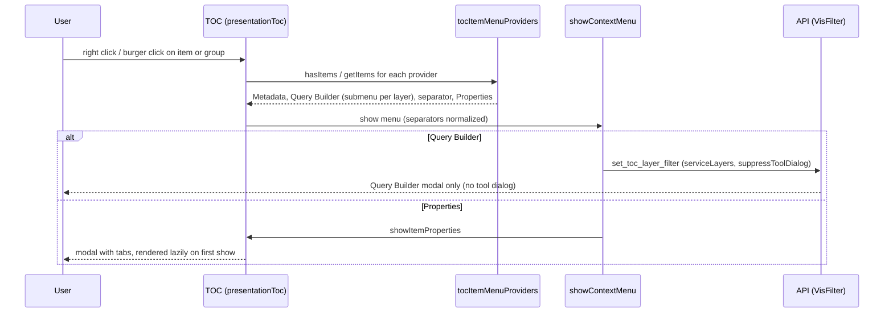
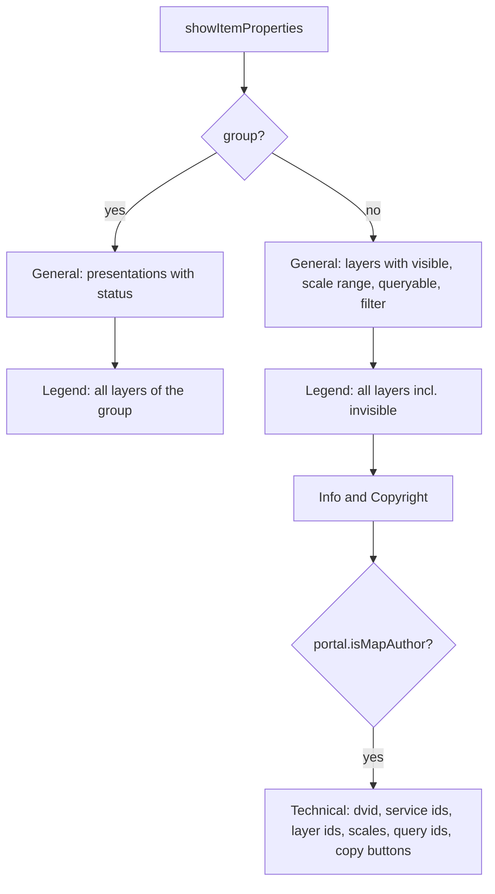

# TOC Context Menu & Properties

## Overview

Every presentation (Darstellungsvariante) and every group in the viewer's table of contents (TOC)
has a context menu, opened by right click or by a burger icon shown on hover. The menu entries come
from a small provider list (Metadata, Query Builder per layer, Darstellung, Beschriftung, filter
reset, Properties), so new TOC tools can be added without touching the TOC build code. "Properties" opens a tabbed dialog with layer details,
legend, info/copyright and (for map authors) technical ids.

## Affected projects

| Project | Role |
|---------|------|
| `webgis-api` | Viewer JS/CSS: TOC plugin, context menu plugin, Query Builder, tool handling, l10n |
| `webgis-portal` | Sets `webgis.globals.portal.isMapAuthor` for the map author (technical tab) |
| `E.Standard.WebGIS.Tools` | Server tool `webgis.tools.presentation.visfilter` (`set_toc_layer_filter`) opened from the menu |

## Key classes / files

| Class / file | Responsibility |
|--------------|----------------|
| `webgis_presentationToc` (`src/NetCore/Web/Api/wwwroot/scripts/api/ui/webgis.ui.plugins.presentationToc.js`) | Builds the TOC. Static methods: `tocItemMenuProviders`, `addItemMenu`, `showItemContextMenu`, `collectItemLayers`, `getItemMap`, `showItemProperties` and the `_render*` tab renderers, `zoomToLayerScale`, `removeTocLayerFilters`, `appendServiceDescription` (shared with the legend dialog) |
| `webgis.ui.showContextMenu` (`.../ui/webgis.ui.plugins.contextMenu.js`) | Generic context menu: items, separators, `checked` items, hover submenus (`items`), flips submenus left at the screen edge |
| `webgis.tools.onButtonClick` / server command handling (`.../api/webgis.tools.js`) | `suppressToolDialog`: run a server tool command and show only its response UI (modal), not the tool dialog of the button |
| Query Builder (`.../ui/webgis.ui.builder.querybuilder.js`, `.../ui/webgis.ui.plugins.querybuilder.js`) | Passes `suppressToolDialog` through to follow-up commands of the Query Builder |
| `VisFilter` (`src/NetStandard/E.Standard.WebGIS.Tools/Presentation/VisFilter.cs`) | `set_toc_layer_filter`: Query Builder for the given service layers; filter id `#TOC#~{serviceId}~{layerId}` |
| `webgis-map.js` (`src/NetCore/Web/Portal/wwwroot/scripts/webgis-map.js`) | Sets `webgis.globals.portal.isMapAuthor = true` when the current user is the map author |
| `default.css` (`src/NetCore/Web/Api/wwwroot/content/styles/default.css`) | Burger icon (hover only), group title burger (float right), submenu styles, `.webgis-toc-properties-*` dialog styles, copy buttons |
| `webgis.l10n.de.js` / `webgis.l10n.en.js` (`src/NetCore/Web/Api/wwwroot/scripts/api/`) | `toc-item-menu*` and `toc-props-*` texts |

## Flow

## Configuration

| Setting | Where | Default | Description |
|---------|-------|---------|-------------|
| `webgis.usability.allowTocVisFilters` | `custom.js` | `false` | Shows the Query Builder entry (only for items with TOC layers) |
| `webgis.globals.portal.isMapAuthor` | set by Portal (`webgis-map.js`) | `undefined` | Shows the "Technical" tab; not configurable via `custom.js` |
| `toc-contextmenu:*` | `api.config` | `false` | `allow-toc-visfilter` (Query Builder, section formerly `tool-visfilter`), `allow-toc-userrenderer`, `allow-toc-userlabeling` |

User docs: https://docs.webgiscloud.com/en/webgis-manual/mapviewer/presentation/index.html#toc-context-menu

## Design decisions

- **Every item and group always has a menu** ("Properties" is always present, last, after a
  separator). This keeps the UI consistent and allows suppressing the browser context menu in the
  whole TOC (holder-wide `contextmenu` handler, except in inputs).
- **Desktop first:** the burger is shown on hover only (also on touch-capable devices, where it was
  annoying for mouse users); on touch, long press opens the context menu.
- **Provider list** instead of hard-coded entries: future tools (table, display settings) are new
  providers. Metadata is always for the whole presentation; per-layer tools use a hover submenu
  with "All" first.
- **Query Builder without tool dialog:** opening it from the menu must not show an empty tool
  dialog, hence `suppressToolDialog` instead of a separate tool.
- **Map author only from the Portal** (`webgis.globals.portal.isMapAuthor`), no `custom.js` option,
  so technical ids are not shown to normal users. Service urls are never shown.
- **Lazy, rebuilt dialog:** tabs render on first show (legend requests) and the dialog is rebuilt on
  every open, so it always reflects the current map state.
- **Copy buttons** (shown on row hover) instead of enabling text selection, because the viewer
  disables `user-select` globally (`content/api/ui.app.css`).

## Pitfalls / things to watch

- Layer scale semantics: visible if `minscale <= scale <= maxscale`, compared with
  `map.crsScale()`, while `map.setScale` uses `map.scale()`; `zoomToLayerScale` converts between
  both and prefers a map zoom level inside the range (otherwise `setScale` snaps outside it).
- `map.unsetFilter` does not refresh services; `removeTocLayerFilters` refreshes the affected
  services and calls `map.ui.refreshUIElements()`.
- Group title layout: the group i-icon is absolutely positioned without a positioned ancestor, so
  the group burger must float right; do not make the title `position: relative`.
- `isMapAuthor` is set asynchronously by the Portal after the map is loaded; it is read when the
  dialog opens, not when the TOC is built.
- Legend for invisible layers depends on the service's legend response; if nothing is returned a
  hint is shown.
- Test manually: item and group menus (right click and burger), Query Builder per layer/all
  (no empty tool dialog), properties of an out-of-scale layer (zoom action), filter removal, the
  technical tab as map author.

## Extension points (optional)

- Add a new menu entry: push a provider `{ hasItems($li), getItems($li, map) }` into
  `$.fn.webgis_presentationToc.plugin.tocItemMenuProviders` (before the properties provider).
  `getItems` returns context menu items (`text`, `icon`, `checked`, `items` for a submenu,
  `separator`, `data.action`). `collectItemLayers($li, map)` returns the layers of an item or group.
- "Darstellung" / "Beschriftung", their reset entries and the item badges (renderer, labeling,
  filter, metadata; click opens the context menu) are described in
  [User Renderer & User Labeling](user-renderer-labeling.md).
- Add a properties tab: extend the `tabs` list in `showItemProperties` with a `render($tab, $li, map)`.

## History

| Version | Change | Reference |
|---------|--------|-----------|
| `9.26.4104` | TOC context menu (items and groups), Query Builder per layer, properties dialog | `8a1abb54` |
| `9.26.4104` | Providers Darstellung/Beschriftung/Filter reset, item badges, api.config section `toc-contextmenu` | [user-renderer-labeling.md](user-renderer-labeling.md) |
