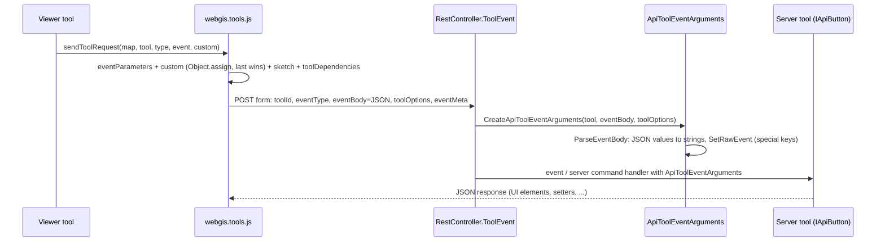

# Tool Events (`/rest/toolevent`)

## Overview

Viewer tools (buttons, click/box tools, sketch tools, uploads) talk to their server-side
implementation via `POST /rest/toolevent`. The client collects all event parameters (tool
parameters, event data, sketch, map dependencies) into one flat JSON object and posts it in the
form field `eventBody`; the server parses it into `ApiToolEventArguments`, which the tools read.

## Affected projects

| Project | Role |
|---------|------|
| `webgis-api` | `RestController.ToolEvent` endpoint, `RestToolsHelperService`, `StorageController` (`__res` roundtrip), viewer JS `webgis.tools.js` |
| `E.Standard.WebMapping.Core.Api` | `ApiToolEventArguments`: parses `eventBody`, normalizes values, special-key handling |
| `E.Standard.Api.App` | `WebStorage`: forwards the current event arguments (`__res`) to `/storage/{method}` |
| `E.Standard.WebMapping.Core.Api.Tests` | Unit tests for `eventBody` parsing (`ApiToolEventArgumentsTests`) |

## Key classes / files

| Class / file | Responsibility |
|--------------|----------------|
| `webgis.tools` (`src/NetCore/Web/Api/wwwroot/scripts/api/webgis.tools.js`) | `sendToolRequest`, `uploadFile`, `fireActiveToolEvents`; builds the parameter object via `eventParameters` → `toolParameters` → custom params → sketch → `toolDependencies` |
| `webgis.tools.mouseEvent` / `boxEvent` / `geoRefDefEvent` / `wrapperEvent` (same file) | Event classes; each provides `toEventParameters(map, tool)` returning a plain object |
| `RestController.ToolEvent` (`src/NetCore/Web/Api/Controllers/RestController.cs`) | Endpoint; receives `toolId`, `eventType`, `eventBody`, `toolOptions` (+ `eventMeta`, HMAC, visfilter/labeling params) |
| `RestToolsHelperService.CreateApiToolEventArguments` (`src/NetCore/Web/Api/AppCode/Services/Rest/RestToolsHelperService.cs`) | Creates `ApiToolEventArguments` with the tool configuration |
| `ApiToolEventArguments` (`src/NetStandard/E.Standard.WebMapping.Core.Api/ApiToolEventArguments.cs`) | `ParseEventBody` (JSON → string key/values), `RawEventBody`, `RawEvent` (ExpandoObject of strings), special keys (`_sketch`, `_mapcrs`, `_selectioninfo`, `_deviceinfo`, ...) |
| `WebStorage` (`src/NetStandard/E.Standard.Api.App/IO/WebStorage.cs`) / `StorageController` (`src/NetCore/Web/Api/Controllers/StorageController.cs`) | Server-to-server `__res` roundtrip: `RawEventBody` is encrypted, posted and rebuilt via `new ApiToolEventArguments(rawEventBody)` |

## Flow

Value normalization in `ParseEventBody` (root must be a JSON object, empty body = no parameters):

| JSON value | `RawEvent` string |
|------------|-------------------|
| string | unchanged |
| number | raw JSON text |
| bool | `"true"` / `"false"` |
| null | null (indexer returns `""`) |
| object | raw JSON text |
| array | comma-joined items (recursively normalized) |

## Configuration

None.

## Design decisions

- **Form field instead of a full JSON request body**: HMAC validation, middleware and the
  `FormOrQuery` helpers read form/query values, a JSON body would trigger CORS preflights, and file
  uploads (`uploadFile`) need multipart anyway. Only the event payload became JSON; `toolOptions`,
  `eventMeta`, HMAC and visfilter/labeling parameters stay separate form fields.
- **Normalize to strings on the server**: all `ApiToolEventArguments` getters (`GetInt`,
  `GetArray` splitting on `,`, `GetBoolean`, `ToClickEvent`, ...) work on strings, so the
  normalization keeps every existing tool unchanged while the client can send native types
  (arrays for `_mapbbox`/`_mapsize`/`box`, objects for `_selectioninfo`/`_deviceinfo`/`_sketchInfo`).
- **No legacy support**: the former pipe-separated `eventString` (with `~~~&PIPE;~~~` escaping,
  `toolParameterString`, `toEventString`, `toClickString`, `RawEventString`) was removed in v9
  without fallback. The JS API is always loaded from the same API instance, so old clients cannot
  call a newer server.
- The `NameValueCollection` constructor (used by `RestController.ToolMethod`, `RestEditingHelperService`,
  `RestPrintHelperService`, `ApiToolsService`) serializes its values
  to JSON and goes through the same parser, so values containing `|` are no longer split.

## Pitfalls / things to watch

- Tool parameter values from the DOM (`toParameterValue`) are still sent as strings; multi-select
  values arrive as JSON array text, as before.
- `customEventStringObject` is sometimes an array used as a dictionary (`[]` with string keys);
  `Object.assign` copies these keys correctly.
- `ApiToolEventArguments.ToClickEvent` needs `CoreApiGlobals.SRefStore` - not available in plain
  unit tests.
- `__res` is never persisted, it only lives for one server-to-server call.
- Debugging: with `webgis.logLevel = 'debug'` (or `'trace'`) in the browser console,
  `webgis.tools.toEventBody` sends `eventBody` indented and logs the parameter object via
  `webgis.log`; otherwise it is compact. The server parses both identically.

## History

| Version | Change | Reference |
|---------|--------|-----------|
| `9.26.4104` | `eventString` (pipe-separated) replaced by JSON form field `eventBody` | branch `v9-tool-json-body` |
