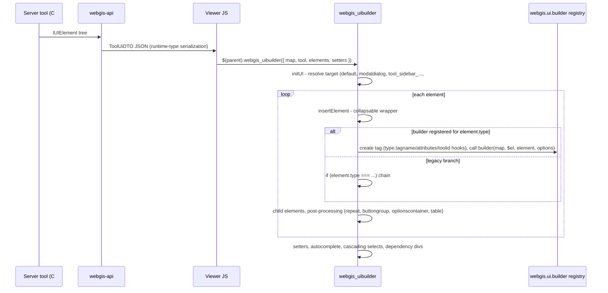
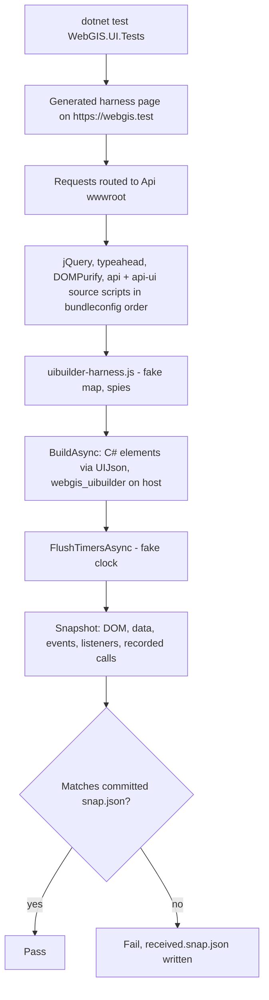

# UI Builder

## Overview

The viewer builds tool dialogs, sidebars and modal content from JSON UI element descriptions sent by the
WebGIS API (`IUIElement` objects such as `UILabel`, `UIInputText`, `UIButton`). The jQuery plugin
`webgis_uibuilder` turns these elements into DOM, wires events and talks to the map. Element types are
being moved step by step from one large `if (element.type === ...)` chain into small, registered
builder plugins (`webgis.ui.builder[type]`), secured by browser-based characterization tests.

## Affected projects

| Project | Role |
|---------|------|
| `E.Standard.WebMapping.Core.Api` | C# UI element classes (`UI/Elements`), interfaces `IUIElement` / `IUISetter` |
| `E.Standard.Api.App` | `ToolUiDTO` (elements, setters, append) sent to the viewer |
| `webgis-api` | Serializes the UI (polymorphic converters), hosts the viewer JS in `wwwroot` and the bundles |
| `webgis-portal` | Loads the bundles (production) or single source scripts (development) |
| `WebGIS.UI.Tests` | Playwright characterization tests (golden master) for the UI builder |

## Key classes / files

| Class / file | Responsibility |
|--------------|----------------|
| `UIElement` (`src/NetStandard/E.Standard.WebMapping.Core.Api/UI/Elements/UIElement.cs`) | Base class of all UI elements (`type`, `id`, `css`, `target`, child `elements`, ...) |
| `ToolUiDTO` (`src/NetStandard/E.Standard.Api.App/DTOs/Events/ToolUiDTO.cs`) | Response payload with `elements`, `setters`, `append` |
| `GenericPolymorphicConverter<T>` (`src/NetCore/Web/Api/AppCode/Json/Converters/GenericPolymorphicConverter.cs`) | Serializes `IUIElement`/`IUISetter` with their runtime type (`UIElementConverter`, `UISetterConverter`) |
| `JsonSerializerOptionsExtensions.AddServerDefaults` (`src/NetCore/Web/Api/AppCode/Extensions/JsonSerializerOptionsExtensions.cs`) | Registers these converters at API startup (`Startup.cs`) |
| `webgis_uibuilder.js` (`src/NetCore/Web/Api/wwwroot/scripts/api/ui/webgis_uibuilder.js`) | `$.fn.webgis_uibuilder`: `initUI` (target routing, setters, cascading selects, dependencies), private `insertElement` (per-element DOM), helpers `elementProperties` (also exposed as `webgis.ui.elementProperties` for builders), `appendElementEvents` |
| `webgis.ui.plugins.js` (`.../scripts/api/ui/webgis.ui.plugins.js`) | Defines the `webgis.ui.builder` registry and `webgis.ui.definePlugin` |
| `webgis.ui.plugins.general.js` (`.../scripts/api/ui/`) | Builders `label`, `paragraph`, `title`; shared helper `webgis.ui.appendCallback` (binds `element.callback` - tool event / server command - to the element click) |
| `webgis.ui.plugins.inputs.js` (`.../scripts/api/ui/`) | Builders `input-text`, `input-textarea`, `input-date`, `input-number`, `hidden`, `input-autocomplete` |
| `webgis.ui.plugins.buttons.js` (`.../scripts/api/ui/`) | Builders `button`, `imagebutton`, `buttongroup`, `undobutton` |
| `webgis.ui.plugins.menus.js` (`.../scripts/api/ui/`) | Builders `menu`, `menuitem` (uses the shared `webgis.ui.appendCallback` from `webgis.ui.plugins.general.js`) |
| `webgis.ui.plugins.lists.js` (`.../scripts/api/ui/`) | Builders `checkable-div`, `option-list`, `option-list-item`, `optionscontainer`, `click-toggle`, `drop-list`; jQuery plugin `webgis_clickToggle` |
| `webgis.ui.plugins.visfilter.js` (`.../scripts/api/ui/`) | Builders `visfiltercombo`, `visfilterlist` |
| `bundleconfig.json` (`src/NetCore/Web/Api/bundleconfig.json`) | Script order of `api.min.js` and `api-ui.min.js` |
| `Views/Map/Index.cshtml`, `Views/MapBuilder/Index.cshtml` (`src/NetCore/Web/Portal/`) | Development script lists (must list new plugin files too) |
| `UIBuilderPageTest` (`src/NetCore/Tests/WebGIS.UI.Tests/Infrastructure/UIBuilderPageTest.cs`) | Test base class: routing, harness page, determinism, `BuildAsync`, `AssertSnapshotAsync` |
| `UIJson` (`.../WebGIS.UI.Tests/Infrastructure/UIJson.cs`) | Serializes C# UI elements like the API does |
| `Snapshot` (`.../WebGIS.UI.Tests/Infrastructure/Snapshot.cs`) | Golden-master files `Snapshots/<type>/<variant>.snap.json` |
| `uibuilder-harness.js`, `harness-init.js` (`.../WebGIS.UI.Tests/Harness/`) | Recording fake map, spies, DOM serializer; seeded `Math.random`, native listener tracking |

## Flow

## Configuration

| Setting | Where | Default | Description |
|---------|-------|---------|-------------|
| `WEBGIS_UPDATE_SNAPSHOTS` | environment variable (tests only) | not set | `1` overwrites all snapshots (tests become Inconclusive) |

No runtime configuration; the builder API is internal to the viewer.

## Design decisions

- **Registry instead of if-chain:** `webgis.ui.builder[type]` keeps `webgis_uibuilder.js` small and
  lets element types live in themed plugin files. Optional hooks next to the builder:
  - `type.tagname` - tag to create (default `div`)
  - `type.attributes` - extra attributes (string or `fn(element, options)`), placed before `elementProperties`
  - `type.toolid` - `false` suppresses `data-tool-id` (inputs historically never got it)
  - `type.formelement` - `true` adds `add_webgis_form_element_events()` (form-container dirty tracking)
  - `type.properties` - `false` skips `elementProperties` completely (`buttongroup` ignores id/css/style)
  - `type.afterinsert` - `fn(map, $el, element, options)` called after the child elements are inserted
  - return value of the builder - an optional jQuery element that replaces `$newElement` (events, `element-target`,
    child elements, `afterinsert` then apply to it; `option-list` returns its inner `ul`)
  A `type.create` hook (builder creates the element itself) is only added when a package really needs it.
- **Characterization tests first:** the existing behaviour is not specified anywhere, so the current
  output (DOM + events + map calls) is recorded as golden master before code is moved.
- **Real browser, no server:** Playwright with request routing to `wwwroot` tests the real scripts
  without starting the API; `webgis.init()` is not called and `map` is a recording fake.
- **Source files, not bundles:** tests load the source scripts in `bundleconfig.json` order (read at
  runtime), because the minified bundles are build artifacts and may be stale. One smoke test covers the bundles.
- **Fixtures from C# classes:** elements are built from the real `UI/Elements` classes and serialized
  like the API (runtime type), so tests break if the server contract changes.

## Pitfalls / things to watch

- New plugin files must be added to `bundleconfig.json` (`api-ui.min.js`, after
  `webgis.ui.plugins.general.js`) **and** to the development script lists in the Portal
  `Views/Map/Index.cshtml` and `Views/MapBuilder/Index.cshtml`.
- A builder registered in `webgis.ui.builder` wins over the legacy if-branch for the same type -
  remove the old branch in the same change.
- `elementProperties(element, options)` produces id/class/style/data attributes; builders get an
  already created element and must not duplicate those attributes. Builders that need the same
  attributes on an additional element (hidden value inputs of `checkable-div`, `option-list`, `drop-list`) use
  `webgis.ui.elementProperties(element, options)`.
- Serializing `IUIElement[]` with plain System.Text.Json drops derived properties (e.g. `label`);
  the API relies on `AddServerDefaults()` - tests use `UIJson` for the same reason.
- Tests: `Microsoft.Playwright.MSTest.v4` is required for MSTest 4; after package updates run
  `playwright.ps1 install chromium` (see the test project README).
- Determinism: the Playwright clock keeps running after install, so the harness pauses it;
  `FlushTimersAsync` advances it to run `webgis.delayed`/`setTimeout`. Never use `$(fn)` readiness in the harness.
- During a refactoring, snapshots must stay unchanged; an Inconclusive result (new snapshot) counts as failure.
- Moved builders must reproduce the old attribute order exactly (e.g. `input-number` still renders
  `min='undefined'` when no range is set) - snapshots compare the DOM literally.
- The minified bundles (`api-ui.min.js`) are regenerated by BuildBundlerMinifier when `webgis-api` is
  built; the viewer in bundle mode only sees new plugin files after a rebuild.

## Extension points

- New builder: register `webgis.ui.builder["<type>"] = (map, $newElement, element, options) => {...}`
  (optional hooks `"<type>.tagname"`, `.attributes`, `.toolid`, `.formelement`, `.properties`, `.afterinsert`, optional return value)
  in a themed `webgis.ui.plugins.<topic>.js` file.
- New test: derive from `UIBuilderPageTest`, `BuildAsync(...)` then `AssertSnapshotAsync("<type>", "<variant>")`;
  configure the fake map via the `setup` argument (`h => h.returns('map.<path>', value)`).

## History

| Version | Change | Reference |
|---------|--------|-----------|
| `9.26.4104` | Characterization test infrastructure (WebGIS.UI.Tests) for the UI builder | uncommitted |
| `9.26.4104` | Input elements moved to `webgis.ui.plugins.inputs.js`; builder hooks `attributes`, `toolid`, `formelement` | uncommitted |
| `9.26.4104` | Button elements moved to `webgis.ui.plugins.buttons.js`; builder hooks `properties`, `afterinsert` | uncommitted |
| `9.26.4104` | Menu elements moved to `webgis.ui.plugins.menus.js`; `appendCallback` became the shared helper `webgis.ui.appendCallback` (`general.js`) | uncommitted |
| `9.26.4104` | List elements (and `webgis_clickToggle`) moved to `webgis.ui.plugins.lists.js`; builder return value hook, `webgis.ui.elementProperties` | uncommitted |
