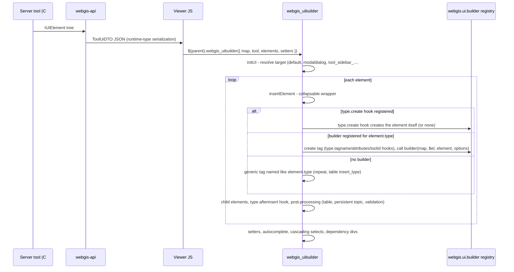
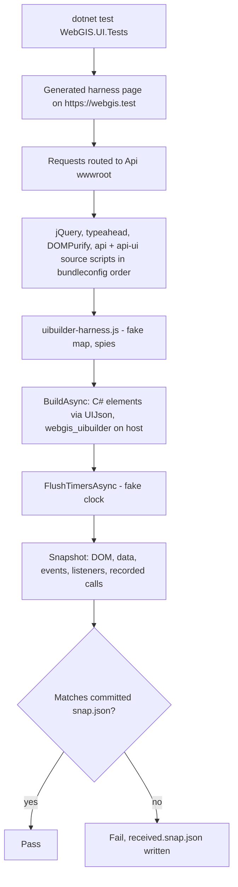

# UI Builder

## Overview

The viewer builds tool dialogs, sidebars and modal content from JSON UI element descriptions sent by the
WebGIS API (`IUIElement` objects such as `UILabel`, `UIInputText`, `UIButton`). The jQuery plugin
`webgis_uibuilder` turns these elements into DOM, wires events and talks to the map. Element types are
being moved step by step from one large `if (element.type === ...)` chain into small, registered
builder plugins (`webgis.ui.builder[type]`), secured by browser-based characterization tests.

## Affected projects

| Project | Role |
|---------|------|
| `E.Standard.WebMapping.Core.Api` | C# UI element classes (`UI/Elements`), interfaces `IUIElement` / `IUISetter` |
| `E.Standard.Api.App` | `ToolUiDTO` (elements, setters, append) sent to the viewer |
| `webgis-api` | Serializes the UI (polymorphic converters), hosts the viewer JS in `wwwroot` and the bundles |
| `webgis-portal` | Loads the bundles (production) or single source scripts (development) |
| `WebGIS.UI.Tests` | Playwright characterization tests (golden master) for the UI builder |

## Key classes / files

| Class / file | Responsibility |
|--------------|----------------|
| `UIElement` (`src/NetStandard/E.Standard.WebMapping.Core.Api/UI/Elements/UIElement.cs`) | Base class of all UI elements (`type`, `id`, `css`, `target`, child `elements`, ...) |
| `ToolUiDTO` (`src/NetStandard/E.Standard.Api.App/DTOs/Events/ToolUiDTO.cs`) | Response payload with `elements`, `setters`, `append` |
| `GenericPolymorphicConverter<T>` (`src/NetCore/Web/Api/AppCode/Json/Converters/GenericPolymorphicConverter.cs`) | Serializes `IUIElement`/`IUISetter` with their runtime type (`UIElementConverter`, `UISetterConverter`) |
| `JsonSerializerOptionsExtensions.AddServerDefaults` (`src/NetCore/Web/Api/AppCode/Extensions/JsonSerializerOptionsExtensions.cs`) | Registers these converters at API startup (`Startup.cs`) |
| `webgis_uibuilder.js` (`src/NetCore/Web/Api/wwwroot/scripts/api/ui/webgis_uibuilder.js`) | `$.fn.webgis_uibuilder`: `initUI` (target routing, setters, cascading selects, dependencies), private `insertElement` (per-element DOM), helpers `elementProperties` (also exposed as `webgis.ui.elementProperties` for builders), `appendElementEvents` |
| `webgis.ui.plugins.js` (`.../scripts/api/ui/webgis.ui.plugins.js`) | Defines `webgis.ui.definePlugin` (UI plugin registry) |
| `webgis.ui.builder.js` (`.../scripts/api/ui/webgis.ui.builder.js`) | Defines the `webgis.ui.builder` registry; header comment describes the builder hooks and the file naming |
| `webgis.ui.builder.general.js` (`.../scripts/api/ui/`) | Builders `label`, `paragraph`, `title`, `card` (plugins `webgis_clickNote`, `webgis_card`, `webgis_buttonGroup`, `webgis_dateCombo`, `webgis_ui_element` in `webgis.ui.plugins.general.js`); shared helper `webgis.ui.appendCallback` (binds `element.callback` - tool event / server command - to the element click) |
| `webgis.ui.builder.inputs.js` (`.../scripts/api/ui/`) | Builders `input-text`, `input-textarea`, `input-date`, `input-number`, `hidden`, `input-autocomplete`, `input-bbox`, `input-size` (plugins `webgis_bbox_input`, `webgis_size_input` in `webgis.ui.plugins.bbox_input.js` / `webgis.ui.plugins.size_input.js`, also used by the builder setters and `webgis.tools.js`) |
| `webgis.ui.builder.buttons.js` (`.../scripts/api/ui/`) | Builders `button`, `imagebutton`, `buttongroup`, `undobutton` |
| `webgis.ui.builder.menus.js` (`.../scripts/api/ui/`) | Builders `menu`, `menuitem` (uses the shared `webgis.ui.appendCallback` from `webgis.ui.builder.general.js`) |
| `webgis.ui.builder.lists.js` (`.../scripts/api/ui/`) | Builders `checkable-div`, `option-list`, `option-list-item`, `optionscontainer`, `click-toggle`, `drop-list` (plugin `webgis_clickToggle` in `webgis.ui.plugins.lists.js`) |
| `webgis.ui.builder.combos.js` (`.../scripts/api/ui/`) | Builders `select`, `querycombo`, `editthemecombo`, `editthemetree`, `chainagethemecombo`, `labelingcombo`, `circleradiuscombo`, `print-query-labelfield-combo`, `print-coordinates-labelfield-combo`, `sketchselect` (plugin `webgis_multi_select` for the print label combos in `webgis.ui.plugins.multi_select.js`). The combo plugins themselves (`webgis_queryCombo`, `webgis_editthemeCombo`, `webgis_editthemeTree`, ...) stay in their own files, because they are also used outside the builder |
| `webgis.ui.builder.upload.js` (`.../scripts/api/ui/`) | Builders `upload-file` (button + hidden file input, calls `webgis.tools.uploadFile`) and `upload-file-control` (wraps `webgis_control_upload`, which lives in `webgis.ui.plugins.control_upload.js` because the collector plugins use it too) |
| `webgis.ui.builder.misc.js` (`.../scripts/api/ui/`) | Builders `literal`, `literal-bold`, `image`, `condition_div`, `opacity-control`, `ui-liveshare`, `static-overlay-control`, `image-selector`, `graphics-info-container`, `graphics-info-stage`, `sketch-info-container`, `sharelink-buttons` (plugins `webgis_image_selector`, `webgis_liveshare`, `webgis_staticOverlayControl` in `webgis.ui.plugins.<name>.js`). `webgis_opacity_control` lives in `webgis_serviceControls.js` (also used by the TOC) |
| `webgis_serviceControls.js`, `webgis_mapContextMenu.js`, `webgis.ui.plugins.form.js`, `webgis.ui.plugins.collapsable_paragraph.js`, `webgis.ui.plugins.general_input.js` (`.../scripts/api/ui/`) | jQuery plugins without element type, moved out of `webgis_uibuilder.js` (`webgis_form`, `webgis_collapsable_paragraph`, `webgis_general_input` since converted to `definePlugin`): `webgis_opacity_control`/`webgis_focusservice_control` (TOC, static overlay, `opacity-control`), `webgis_map_contextmenu` (`webgis.map.js`), `webgis_form` (sketch modules), `webgis_collapsable_paragraph`/`webgis_general_input` (presentation TOC, add services TOC). Builder internals `webgis_tool_persist_topic_handler` and `add_webgis_form_element_events` stay in `webgis_uibuilder.js` |
| `webgis.ui.builder.visfilter.js` (`.../scripts/api/ui/`) | Builders `visfiltercombo`, `visfilterlist` (plugins in `webgis.ui.plugins.visfilter.js`) |
| `webgis.ui.builder.timefilter.js`, `webgis.ui.builder.querybuilder.js` (`.../scripts/api/ui/`) | Builders `timefiltercontrol`, `timefilterlist`, `query-builder` (plugins in `webgis.ui.plugins.timefilter.js`, `webgis.ui.plugins.querybuilder.js`) |
| `bundleconfig.json` (`src/NetCore/Web/Api/bundleconfig.json`) | Script order of `api.min.js` and `api-ui.min.js` |
| `Views/Map/Index.cshtml`, `Views/MapBuilder/Index.cshtml` (`src/NetCore/Web/Portal/`) | Development script lists (must list new plugin files too) |
| `UIBuilderPageTest` (`src/NetCore/Tests/WebGIS.UI.Tests/Infrastructure/UIBuilderPageTest.cs`) | Test base class: routing, harness page, determinism, `BuildAsync`, `AssertSnapshotAsync` |
| `UIJson` (`.../WebGIS.UI.Tests/Infrastructure/UIJson.cs`) | Serializes C# UI elements like the API does |
| `Snapshot` (`.../WebGIS.UI.Tests/Infrastructure/Snapshot.cs`) | Golden-master files `Snapshots/<type>/<variant>.snap.json` |
| `uibuilder-harness.js`, `harness-init.js` (`.../WebGIS.UI.Tests/Harness/`) | Recording fake map, spies, DOM serializer; seeded `Math.random`, native listener tracking |

## Flow

## Configuration

| Setting | Where | Default | Description |
|---------|-------|---------|-------------|
| `WEBGIS_UPDATE_SNAPSHOTS` | environment variable (tests only) | not set | `1` overwrites all snapshots (tests become Inconclusive) |

No runtime configuration; the builder API is internal to the viewer.

## Design decisions

- **File naming:** files that register element builders are called `webgis.ui.builder.<topic>.js` (builders and
  builder-related helpers only); `webgis.ui.definePlugin` plugins (the current plugin format) of a topic live in
  `webgis.ui.plugins.<topic>.js`; legacy `$.fn` jQuery plugins live in `webgis_<pluginName>.js` until they are converted
  to `definePlugin`.
  Plugin files load before the builder files (`bundleconfig.json`). `webgis.ui.builder.js` (registry) groups the builder files in Visual Studio (file nesting).
- **Registry instead of if-chain:** `webgis.ui.builder[type]` keeps `webgis_uibuilder.js` small and
  lets element types live in themed plugin files. Optional hooks next to the builder:
  - `type.tagname` - tag to create (default `div`)
  - `type.attributes` - extra attributes (string or `fn(element, options)`), placed before `elementProperties`
  - `type.toolid` - `false` suppresses `data-tool-id` (inputs historically never got it)
  - `type.formelement` - `true` adds `add_webgis_form_element_events()` (form-container dirty tracking)
  - `type.properties` - `false` skips `elementProperties` completely (`buttongroup` ignores id/css/style)
  - `type.afterinsert` - `fn(map, $el, element, options)` called after the child elements are inserted
  - return value of the builder - an optional jQuery element that replaces `$newElement` (events, `element-target`,
    child elements, `afterinsert` then apply to it; `option-list` returns its inner `ul`)
  - `type.create` - `fn(map, $parent, element, options)` => created jQuery element or `null`; replaces the whole
    element creation (no other hook is used). Without a returned element there are no events, child elements or
    `afterinsert`. Used for elements that do not create exactly one element in the parent: `literal` (appends html),
    `sketch-info-container` (renders into the map overlay or not at all), `condition_div` (generic `<condition_div>`
    tag without condition arguments)
- **Characterization tests first:** the existing behaviour is not specified anywhere, so the current
  output (DOM + events + map calls) is recorded as golden master before code is moved.
- **Real browser, no server:** Playwright with request routing to `wwwroot` tests the real scripts
  without starting the API; `webgis.init()` is not called and `map` is a recording fake.
- **Source files, not bundles:** tests load the source scripts in `bundleconfig.json` order (read at
  runtime), because the minified bundles are build artifacts and may be stale. One smoke test covers the bundles.
- **Fixtures from C# classes:** elements are built from the real `UI/Elements` classes and serialized
  like the API (runtime type), so tests break if the server contract changes.

## Pitfalls / things to watch

- New builder files must be added to `bundleconfig.json` (`api-ui.min.js`, after
  `webgis.ui.builder.js`; new plugin files before it) **and** to the development script lists in the Portal
  `Views/Map/Index.cshtml` and `Views/MapBuilder/Index.cshtml`.
- A builder registered in `webgis.ui.builder` wins over the legacy if-branch for the same type -
  remove the old branch in the same change.
- `elementProperties(element, options)` produces id/class/style/data attributes; builders get an
  already created element and must not duplicate those attributes. Builders that need the same
  attributes on an additional element (hidden value inputs of `checkable-div`, `option-list`, `drop-list`) use
  `webgis.ui.elementProperties(element, options)`.
- Serializing `IUIElement[]` with plain System.Text.Json drops derived properties (e.g. `label`);
  the API relies on `AddServerDefaults()` - tests use `UIJson` for the same reason.
- Tests: `Microsoft.Playwright.MSTest.v4` is required for MSTest 4; after package updates run
  `playwright.ps1 install chromium` (see the test project README).
- Determinism: the Playwright clock keeps running after install, so the harness pauses it;
  `FlushTimersAsync` advances it to run `webgis.delayed`/`setTimeout`. Never use `$(fn)` readiness in the harness.
- During a refactoring, snapshots must stay unchanged; an Inconclusive result (new snapshot) counts as failure.
- Moved builders must reproduce the old attribute order exactly (e.g. `input-number` still renders
  `min='undefined'` when no range is set) - snapshots compare the DOM literally.
- The minified bundles (`api-ui.min.js`) are regenerated by BuildBundlerMinifier when `webgis-api` is
  built; the viewer in bundle mode only sees new plugin files after a rebuild. The bundler only compares the
  timestamps of the input files: if the bundle was regenerated (e.g. by Visual Studio) before the new file was added
  to `bundleconfig.json`, touch one of the input files and build again.
- Combo tests: the combo plugins iterate `map.services` and call service methods (`getLayer`,
  `checkLayerVisibility`, `layerVisibleAndInScale`, ...); fake services in the test setup must provide them.
- `editthemecombo`/`editthemetree` pass `element.dbrights` to their plugins, while the C# classes serialize
  `db_rights` - kept as is (characterized by the `dbrights` snapshots).
- `literal`/`literal-bold` rewrite the parent html, which drops events of already inserted siblings; `input-size`
  has no `webgis-value-element`, so `getElementValue` returns an empty string; `condition_div` reads the misspelled
  properties `codition_logical_operator`/`contition_element_id`; `graphics-info-stage` has no plugin (`webgis_graphicsInfoStage`
  does not exist). All kept as is and characterized by snapshots.
- Asynchronously loaded libraries (`webgis.require`, e.g. `sortable` for `static-overlay-control`) finish after
  `BuildAsync`; wait for the library (`WaitForAsync`) before the snapshot. The harness normalizes Sortable's
  `Sortable<timestamp>` expando key.

## Extension points

- New builder: register `webgis.ui.builder["<type>"] = (map, $newElement, element, options) => {...}`
  (optional hooks `"<type>.tagname"`, `.attributes`, `.toolid`, `.formelement`, `.properties`, `.afterinsert`, optional return value;
  or `"<type>.create"` if the element is created differently)
  in a themed `webgis.ui.builder.<topic>.js` file.
- New test: derive from `UIBuilderPageTest`, `BuildAsync(...)` then `AssertSnapshotAsync("<type>", "<variant>")`;
  configure the fake map via the `setup` argument (`h => h.returns('map.<path>', value)`).

## History

| Version | Change | Reference |
|---------|--------|-----------|
| `9.26.4104` | Characterization test infrastructure (WebGIS.UI.Tests) for the UI builder | uncommitted |
| `9.26.4104` | Input elements moved to `webgis.ui.plugins.inputs.js`; builder hooks `attributes`, `toolid`, `formelement` | uncommitted |
| `9.26.4104` | Button elements moved to `webgis.ui.plugins.buttons.js`; builder hooks `properties`, `afterinsert` | uncommitted |
| `9.26.4104` | Menu elements moved to `webgis.ui.plugins.menus.js`; `appendCallback` became the shared helper `webgis.ui.appendCallback` (`general.js`) | uncommitted |
| `9.26.4104` | List elements (and `webgis_clickToggle`) moved to `webgis.ui.plugins.lists.js`; builder return value hook, `webgis.ui.elementProperties` | uncommitted |
| `9.26.4104` | Combo elements (and `webgis_multi_select`) moved to `webgis.ui.plugins.combos.js` | uncommitted |
| `9.26.4104` | Upload elements moved to `webgis.ui.plugins.upload.js` | uncommitted |
| `9.26.4104` | Misc elements moved to `webgis.ui.plugins.misc.js`, `input-bbox`/`input-size` to `webgis.ui.plugins.inputs.js`; builder hook `create` | uncommitted |
| `9.26.4104` | Remaining jQuery plugins without element type moved to `webgis_serviceControls.js`, `webgis_mapContextMenu.js`, `webgis_form.js`, `webgis_generalControls.js` | uncommitted |
| `9.26.4104` | Builder files renamed from `webgis.ui.plugins.<topic>.js` to `webgis.ui.builder.<topic>.js`; registry moved to `webgis.ui.builder.js`; `definePlugin` plugins split into `webgis.ui.plugins.<topic>.js`, legacy `$.fn` plugins into `webgis_<pluginName>.js` | uncommitted |
| `9.26.4104` | Legacy `$.fn` plugins `webgis_bbox_input`, `webgis_size_input`, `webgis_multi_select`, `webgis_image_selector`, `webgis_form`, `webgis_collapsable_paragraph`, `webgis_general_input`, `webgis_copyright`, `webgis_liveshare`, `webgis_validation`, `webgis_hourglass`, `webgis_control_upload`, `webgis_editthemeCombo`, `webgis_servicesToc`, `webgis_contentsearch`, `webgis_staticOverlayControl`, `webgis_control_search`, `webgis_errors` converted to `webgis.ui.definePlugin` (one `webgis.ui.plugins.<name>.js` each); `webgis_general_input` adds further inputs with the `add` method; `$.servicesToc.checkItemVisibility` became a static method; `webgis_errors('hasErrors')` needs a holder element (`$('.webgis-errors-holder')`) | uncommitted |
