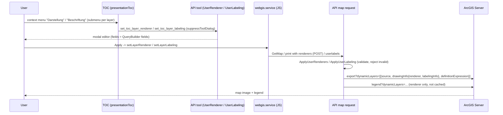
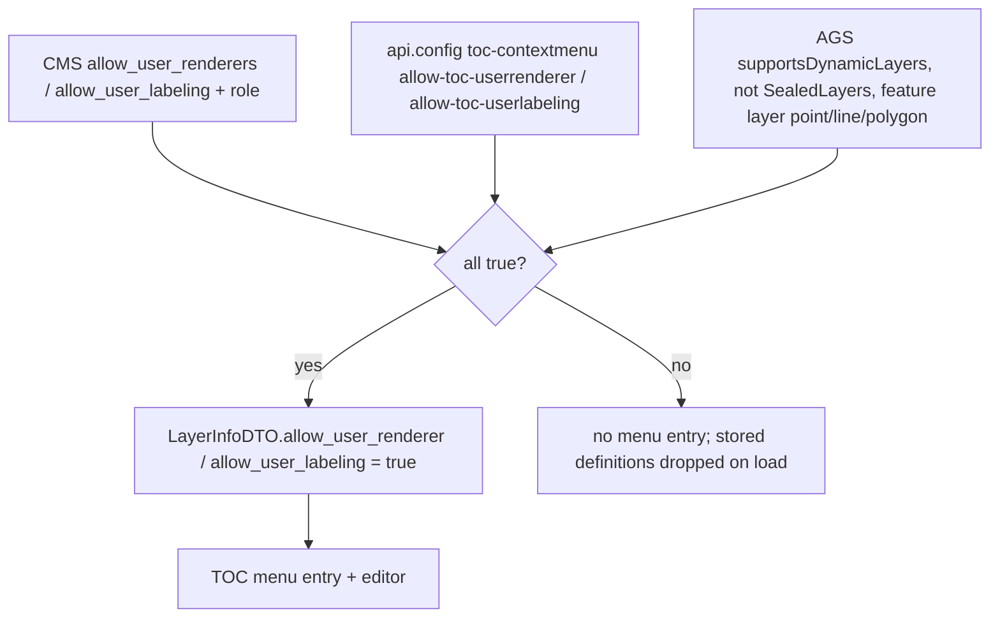

# User Renderer & User Labeling (TOC "Darstellung" / "Beschriftung")

## Overview

Users can change the presentation (renderer: single symbol, unique values, class breaks) and the
labeling (label expression, font, halo, or no labels) of individual layers from the TOC context menu.
The definitions are stored per service layer in the viewer JS, serialized with the map and sent with
every map/print request; the server validates them and translates them into ArcGIS Server
`dynamicLayers` (`drawingInfo.renderer` / `drawingInfo.labelingInfo`). Phase 1 supports AGS map
services only; the neutral model is service independent so other services can follow. User labeling
replaces the legacy `Labeling` tool and the CMS labeling nodes.

## Affected projects

| Project | Role |
|---------|------|
| `E.Standard.WebMapping.Core` | Neutral models (`UserRenderer`, `UserSymbol`, `UserLabeling`, `UserLabelExpression`), settings, validators, capability interfaces |
| `E.Standard.WebMapping.GeoServices` | AGS: `supportsDynamicLayers`, translators to AGS JSON, `dynamicLayers` in export and legend requests |
| `E.Standard.WebMapping.Core.Api` | UI elements `UIRendererEditor`, `UILabelEditor`, DTOs for the editor definitions |
| `E.Standard.WebGIS.Tools` | Server tools `UserRenderer` / `UserLabeling` (dialog, distinct values, field range) |
| `E.Standard.WebGIS.CmsSchema` / `E.Standard.Api.App` | CMS properties `allow_user_renderers` / `allow_user_labeling` (authorizable), `LayerInfoDTO` flags |
| `webgis-api` | Request parameters `renderers` / `userlabels`, applying them to the service, api.config `toc-contextmenu`, viewer JS (state, editors, TOC menu, badges), l10n |

## Key classes / files

| Class / file | Responsibility |
|--------------|----------------|
| `UserRenderer`, `UserSymbol` (`src/NetStandard/E.Standard.WebMapping.Core/Renderer/UserRenderers/`) | Versioned neutral renderer JSON (`simple`, `uniqueValue`, `classBreaks`), symbols for point/line/polygon |
| `UserRendererValidator`, `UserRendererSettings` (same folder) | Field against allowed (QueryBuilder) fields, value ranges, max unique value classes, text lengths |
| `UserLabeling`, `UserLabelExpression`, `UserLabelingValidator`, `UserLabelingSettings` (`.../Core/Renderer/UserLabels/`) | Modes default/none/custom, template `"Text [FIELD]"` (max 200 chars, 3 lines), font size/style/color, halo |
| `IUserRenderableLayer`, `IUserLabelableLayer`, `IMapServiceUserRenderers`, `IMapServiceUserLabeling` (`.../Core/Abstraction/`) | Capability (`SupportsUserRenderer/Labeling`) and per-request state on layer/service |
| `MapService` (`src/NetStandard/E.Standard.WebMapping.GeoServices/ArcServer/Rest/MapService.cs`) | Parses `supportsDynamicLayers`; `SupportsUserRenderers/Labeling` (not for `SealedLayers`); builds one `dynamicLayer` per affected layer in `GetMapAsync` (renderer + labelingInfo + definitionExpression) |
| `AgsUserRendererTranslator`, `AgsUserLabelingTranslator` (`.../ArcServer/Rest/Renderers/`) | Neutral model to AGS REST JSON; label template to legacy `CONCAT`/`NEWLINE` expression |
| `ServiceExtensions` (`.../ArcServer/Rest/Exceptions/ServiceExtensions.cs`) | Legend request with `dynamicLayers`; appends "(FieldAlias)" to the legend layer name for unique values / class breaks |
| `ServiceExtensions.ApplyUserRenderers/ApplyUserLabeling` (`src/NetCore/Web/Api/AppCode/Extensions/ServiceExtensions.cs`) | Parses/validates request JSON against allowed fields, sets state on the service, returns rejected layers |
| `RestApiExtensions`, `RestMappingHelperService` (`src/NetCore/Web/Api/AppCode/...`) | Read `renderers` (POST body) and `userlabels`; apply them for map, legend and print requests |
| `RestHelperService` (`.../AppCode/Services/Rest/RestHelperService.cs`) | `allow_user_renderer` / `allow_user_labeling` on `ServiceInfoDTO.LayerInfoDTO` (CMS auth && layer capability) |
| `ApiGlobalsService` (`.../AppCode/Services/ApiGlobalsService.cs`) | api.config section `toc-contextmenu` |
| `UserRenderer` / `UserLabeling` tools (`src/NetStandard/E.Standard.WebGIS.Tools/Presentation/`) | `set_toc_layer_renderer` (+ `distinct_values`, `field_range`), `set_toc_layer_labeling`: return the editor UI element for a layer |
| `UIRendererEditor`, `UILabelEditor` (`.../Core.Api/UI/Elements/Advanced/`) | UI elements: fields, geometry type, current definition |
| `webgis.ui.builder.renderereditor.js` / `webgis.ui.plugins.renderereditor.js` | Renderer editor dialog (`webgis.ui.definePlugin`) |
| `webgis.ui.builder.labeleditor.js` / `webgis.ui.plugins.labeleditor.js` | Label editor dialog (reuses color picker/helpers of the renderer editor) |
| `webgis.service.js` | `setLayerRenderer/getLayerRenderer/hasLayerRenderer`, `setLayerLabeling/...`, serialization (`layer_renderers`, `layer_labelings`) |
| `webgis.map.js` | Adds `renderers` / `userlabels` to map and print requests |
| `webgis.ui.plugins.presentationToc.js` | Menu providers "Darstellung", "Beschriftung", "Filter zurücksetzen", reset entries, item badges |

## Flow

## Configuration

| Setting | Where | Default | Description |
|---------|-------|---------|-------------|
| `allow_user_renderers` | CMS AGS service ("Benutzerdefinierte Darstellung erlauben") | `false` | Authorizable (roles) |
| `allow_user_labeling` | CMS AGS service ("Benutzerdefinierte Beschriftung erlauben") | `false` | Authorizable (roles) |
| `toc-contextmenu:allow-toc-userrenderer` | `api.config` | `false` | Global switch for "Darstellung" |
| `toc-contextmenu:allow-toc-userlabeling` | `api.config` | `false` | Global switch for "Beschriftung" |
| `toc-contextmenu:userrenderer-max-unique-value-classes` | `api.config` | `100` | Max unique value classes |
| `toc-contextmenu:allow-toc-visfilter` | `api.config` | `false` | Query Builder (section renamed from `tool-visfilter`) |

User/admin docs:
- https://docs.webgiscloud.com/en/webgis-manual/mapviewer/presentation/index.html#toc-user-renderer
- https://docs.webgiscloud.com/en/webgis-manual/mapviewer/presentation/index.html#toc-user-labeling
- https://docs.webgiscloud.com/en/webgis-manual/mapviewer/presentation/index.html#toc-badges
- https://docs.webgiscloud.com/en/webgis/config/api/index.html#api-config-toc-contextmenu
- https://docs.webgiscloud.com/en/webgis/apps/cms/add_ags_service.html#cms-ags-user-renderer-labeling

## Design decisions

- **Default or custom, no round trip:** the original AGS renderer is not translated to the client;
  the user either keeps the service default (legend image of the service) or builds a new renderer.
- **Neutral, versioned model** in Core instead of AGS JSON on the client, so other service types
  can get translators later.
- **Per service layer**, not per presentation: a definition applies in every presentation showing
  the layer, and is serialized with the service (map save, sharing, permalinks).
- **Only QueryBuilder fields** are offered and accepted (server validates again), so users cannot
  render/label by fields the admin did not expose.
- **Separate parameters** `renderers` (POST, can be large) and `userlabels`; invalid definitions are
  rejected per layer and the layer is drawn with its default presentation.
- **Labeling expression** is a simple template (`[FIELD]` + text) translated to the AGS legacy
  `CONCAT`/`NEWLINE` syntax; no Arcade, no placement/font family options. Scale range = layer.
- **Legacy labeling removed** (tool, CMS nodes, `labels` parameter, AXL label renderer path);
  `labels` in old saved maps are ignored.
- **TOC badges** (renderer, labeling, filter, metadata) are passive indicators; clicking them opens
  the context menu instead of toggling visibility.

## Pitfalls / things to watch

- **Scale limits:** layers without scale limits have `MinScale/MaxScale = -1`. Passing `-1` as
  `minScale/maxScale` in `labelingInfo` makes AGS draw no labels; the translator clamps to `0`.
  Note AGS swaps semantics (`labelingInfo.minScale` = largest scale denominator).
- A `labelingInfo` without a symbol draws nothing; bold weight may be ignored depending on the
  service/fonts.
- The legend request excludes `userlabels` (labels don't change the legend) and must not be cached
  for layers with a user renderer.
- Definitions loaded from a saved map are dropped when the layer no longer has the capability flag.
- `RestHelperService` only sets the flags when both CMS authorization and layer capability are true.
- "Load values" / "Calculate classes" respect the display filters of the layer: `UserRenderer` is
  `VisFilterDependent`, the renderer editor sends `visfilter_dependent: true` for its ad-hoc tool
  calls, and the distinct query uses `applyRequestVisFilters: true` (see [Query Builder](querybuilder.md)).
- Tests: `UserRendererValidatorTests`, `UserLabelingValidatorTests` (Core.Tests),
  `AgsUserRendererTranslatorTests`, `AgsUserLabelingTranslatorTests` (GeoServices.Tests). Manually
  check map, legend, print and map save/load.

## Extension points (optional)

- **New service type:** implement `IUserRenderableLayer` / `IUserLabelableLayer` and
  `IMapServiceUserRenderers` / `IMapServiceUserLabeling`, plus a translator into the service's
  native format.
- **New renderer type:** extend `UserRenderer` (+ validator, translator, editor plugin) and bump the
  model `version` if the JSON changes incompatibly.

## History

| Version | Change | Reference |
|---------|--------|-----------|
| `9.26.4104` | User renderer (simple, unique values, class breaks), user labeling, TOC badges, filter reset; legacy labeling removed; `tool-visfilter` renamed to `toc-contextmenu` | `6d55579b`, `c64b70c1`, `4e827a25`, `43b75d77`, `6f9d024b` |
| `9.26.4104` | Distinct values / field range respect display filters and locked filters | branch `v9-querybuilder` |
